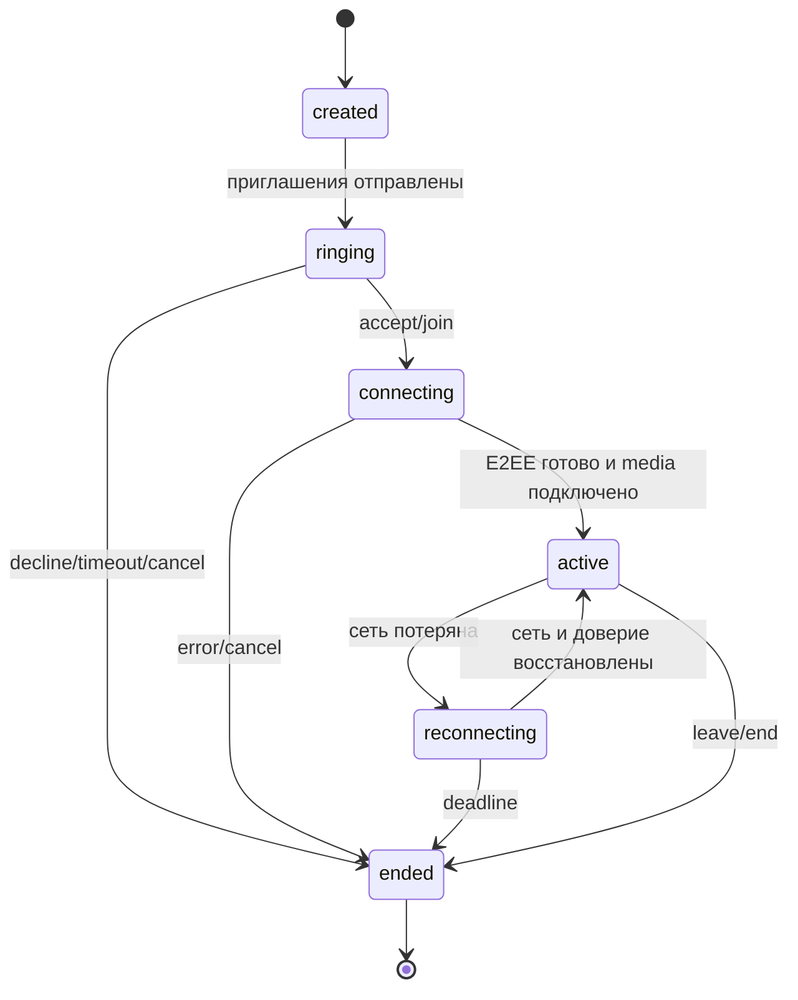
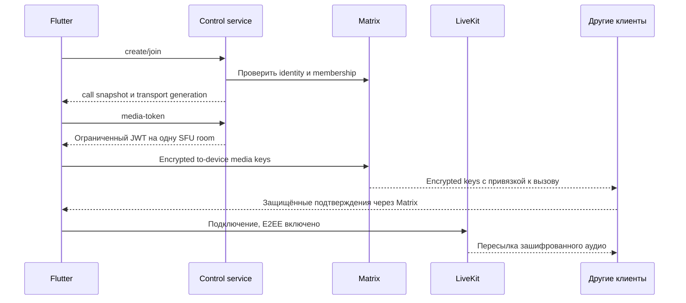

# Звонки: управление, транспорт и ключи

> Дополнение 23 октября 2026: [ТЗ экрана](../screen-sharing-spec.md) и
> [задачи](../tasks/08-screen-sharing.md) расширяют звонки демонстрацией с одним
> ведущим и перехватом. План: отдельное поколение screen room в уже имеющемся
> LiveKit, без изменения транспорта голоса/камер. Обычный media JWT ниже по-прежнему
> запрещает screen share; право появляется только в отдельном экранном контракте.
> Реализация ещё не начата. Фактический control API сейчас Python/SQLite;
> таблица `/api/v1/calls` ниже — прежний проект, не перечень текущих endpoints.

## Разделение каналов

- HTTPS control API: кто звонит, кто может принять/войти, lifecycle и leases.
- SSE control stream: изменения состояния с sequence и восстановлением; отправка команд остаётся HTTP.
- Matrix encrypted to-device: SDP/ICE личного вызова и обмен временными медиаключами группового. Это собственные versioned payload проекта поверх Matrix, а не заявленная совместимость с Element Call/MatrixRTC.
- WebRTC: живой звук; P2P/TURN в личном вызове, SFU в групповом.
- FCM: сигнал пробуждения; не источник истины и не медиатранспорт.

Криптографию транспорта реализуют SDK. Собственный control protocol координирует их, не вводит новый шифр.

## Состояния

Состояние participant отдельно от общего calls.state: группа может быть active, пока конкретный участник reconnecting. Терминальное состояние необратимо, повторное подключение после завершения создаёт новый call_id. В группе инициатор не обязан оставаться до конца; выход последнего участника завершает сеанс после grace period.

Исходные настраиваемые значения: звонить 45 с; heartbeat 10 с, lease 30 с; reconnect budget 60 с; окно idempotency 24 ч. Это параметры прототипа, не SLA.

## Control API v1 (проект контракта)

Все внешние endpoints `/api/v1` требуют Matrix Bearer token, проверяемый локальным Synapse. Идентичность устройства выводится из токена; поле device_id в JSON не даёт полномочий. Mutations принимают `Idempotency-Key`; optimistic `expected_version` защищает от устаревших команд. Ответ содержит актуальные state/version и server time.

| Endpoint | Назначение / проверка |
| --- | --- |
| `PUT /devices/current/push` | Зарегистрировать FCM token только своего текущего устройства |
| `DELETE /devices/current/push` | Отключить push на выходе |
| `POST /calls` | room_id, kind; подтвердить joined membership, право вызова, отсутствие активного сеанса |
| `GET /calls/{id}` | Только разрешённому участнику/приглашённому; без чужих FCM token |
| `POST /calls/{id}/accept` | Выбрать одно отвечающее устройство пользователя атомарно |
| `POST /calls/{id}/join` | Войти в активную группу, атомарно проверить максимум 10 и global lease |
| `POST /calls/{id}/decline` | Отклонить вызов для пользователя; не завершает всю группу |
| `POST /calls/{id}/leave` | Освободить своё участие и запустить ротацию |
| `POST /calls/{id}/end` | Для личного — участник; для группы — владелец/администратор комнаты |
| `POST /calls/{id}/heartbeat` | Продлить только собственный актуальный lease |
| `POST /calls/{id}/media-token` | Только выбранному устройству; повторная membership/lease проверка |
| `GET /calls/{id}/events` | SSE через authenticated fetch, resume с sequence; не передавать token в URL |
| `POST /internal/livekit/webhook` | Только валидная подпись LiveKit, dedup event ID |
| `POST /internal/matrix/change` | Аутентифицированный observer, ACL/device invalidation; не публичный API |

400 — неверный запрос; 401 — сеанс недействителен; 403 — нет права; 409 — гонка версии, уже отвечено/занят/группа заполнена; 410 — вызов завершён; 429 — лимит. Ошибка имеет стабильный code, request_id и безопасное сообщение. После разрыва SSE сначала snapshot, затем события; при устаревшем cursor заново snapshot. REST snapshot остаётся fallback, SSE не хранит критическое состояние только в памяти.

## Личный вызов

1. Инициатор создаёт call в существующем DM. Сервис определяет адресата из membership, не из произвольного списка push tokens.
2. После транзакции сервис отправляет push всем зарегистрированным устройствам адресата. Инициатор отправляет E2EE приглашения допустимым Matrix devices.
3. Проснувшийся клиент проверяет call snapshot и зашифрованное приглашение, показывает системный входящий вызов. Просроченный push игнорируется.
4. Первый успешный accept забирает lease. Остальные устройства получают answered_elsewhere и снимают звонок; при гонке используется результат БД.
5. Только выбранные устройства обмениваются encrypted to-device offer/answer/ICE. Payload содержит protocol_version, call_id, session_generation, sender/recipient device ID, sequence, expires_at. Получатель проверяет криптографического отправителя против payload, текущий lease и binding SDP fingerprints.
6. `flutter_webrtc` — кандидат на P2P-адаптер. ICE использует STUN и временные TURN credentials через Synapse TURN API. Сначала прямой путь; TURN fallback не отключает DTLS-SRTP.
7. Trickle ICE, защита от duplicate/reordered messages, роль offerer детерминирована, renegotiation сериализована. При смене сети ICE restart с новой generation. Старые candidates/answer не применяются.

To-device доставка не гарантирует мгновенное пробуждение приложения; отдельный call push нужен именно поэтому. Параллельная работа Matrix sync из background handler и foreground должна использовать один crypto store owner/блокировку.

## Групповой вызов

Room name LiveKit — случайный непрозрачный ID на media_generation; не постоянный Matrix room ID. Participant identity привязана к call/user/device; дубликат этого identity не создаёт второе разрешённое устройство. Токен выдаётся на одну room с join/subscribe/publish microphone; camera, screen share, roomAdmin, recording и data publishing по умолчанию запрещены. Начальный TTL выдачи — 60 с; серверные API credentials клиенту не выдаются.

Максимум 10 считается по зарезервированным/активным участникам в БД и дополнительно ограничивается SFU. LiveKit webhook не становится единственным источником membership: подпись проверяется, duplicate игнорируется, раз в период сверяем состояние rooms/participants с lease-таблицей.

## Обмен медиаключами

Предпочтение — независимые sender keys с custom key provider LiveKit: каждый отправитель создаёт случайный ключ для своего потока и текущей membership epoch. Через аутентифицированный Olm to-device канал отправляет его только выбранным доверенным устройствам текущих участников. Это исключает единого криптографического лидера вызова.

Envelope: version, call_id, transport_generation, sender identity/device, epoch, key_index, recipient device, expiry, ключ. Принимаем только от аутентифицированного sender, ожидаемого в текущем локально проверенном roster; key_index не переиспользуется в рамках активной session. Индексы и nonce/rachet handling реализует media SDK, не приложение. Возможность per-sender key providers одновременно на Flutter Android/Web — блокирующая проверка; fallback на shared server-known key запрещён.

Ключи временные, не пишутся в комнатную историю, server logs или key backup. To-device ciphertext может сохраняться сервером до доставки, поэтому у него есть expiry и получатель не применяет просроченный материал. В crash dumps ключи не включаются.

При вступлении/выходе/исключении/смене устройства обновляем epoch; каждый отправитель приостанавливает передачу, генерирует новый sender key, рассылает текущим разрешённым получателям и получает acknowledgements. После ограниченного ожидания готовые участники продолжают, неподготовленный не получает медиа и отображается как connecting. Отказ одного клиента не вынуждает перейти на открытый звук. Старые ключи не выдаются новым участникам; новый поток не использует старую эпоху. У получателей допустимо короткое окно обработки уже пришедших старых пакетов без выдачи старых ключей новым устройствам.

Изменения проверяются по Matrix state и подтверждённой identity, не только по серверному списку LiveKit. При утрате достоверного control/membership состояния публикация приостанавливается после короткого grace period: иначе невозможно обещать отзыв доступа во время сетевого разделения. Нулевую задержку отзыва в асинхронной сети не обещаем.

## Исключение и особенность self-hosted LiveKit

Удаление участника не инвалидирует уже выданный self-hosted JWT; кроме того, SDK может иметь обновлённый reconnect token. Поэтому короткий TTL исходного токена недостаточен для немедленного отзыва.

При исключении/отзыве устройства: прекратить новые выдачи → остановить старую публикацию → новая media_generation с новым случайным SFU room name → новые токены только разрешённым устройствам → новые медиаключи → удалить старых участников/room. Старый token остаётся привязанным к старому имени и не даёт доступа к новой конференции. Старую room при необходимости повторно очищает reconciliation; E2EE дополнительно исключает чтение новых потоков. Цена — короткое переподключение группы; для v1 это принимаемый компромисс.

При обычном добровольном выходе достаточно смены ключей и проверки leases, но событие принудительного исключения использует смену room generation. Тестирование с сохранённым refresh token обязательно. [LiveKit tokens](https://docs.livekit.io/frontends/reference/tokens-grants/).

## Сбой, завершение и расширение

- Network loss: SDK reconnect/ICE restart, UI reconnecting; сохраняем выбранное устройство до deadline, затем снимаем lease.
- Backend restart: состояния в PostgreSQL, восстановление через snapshot; expired leases сверяются с SFU. In-memory таймер не единственный механизм завершения.
- Caller cancel и accept гоняются через transaction/version; проигравший получает итоговое состояние.
- Серверное завершение + TTL снимают зависший входящий звонок, даже если cancel push потерялся.
- Android: Core-Telecom и требуемый foreground lifecycle после принятия, audio focus и гарнитуры через платформенный адаптер. FCM high priority только для своевременного видимого вызова. Force-stop и запрет уведомлений обрабатываются как ограничения ОС.
- Браузер: работа в открытом клиенте; фоновые уведомления/закрытый браузер — отдельная матрица возможностей, паритет с Android не обещается.
- Добавление третьего участника: новый групповой сеанс с подтверждением переключения, не скрытое бесшовное изменение P2P.
- Будущее видео: новый capability и grants/track types; аудио-only v1 не запрашивает камеру.

## Источники и проверяемые предположения

- [LiveKit E2EE](https://docs.livekit.io/transport/encryption/)
- [LiveKit access tokens](https://docs.livekit.io/frontends/reference/tokens-grants/)
- [WebRTC TURN](https://webrtc.org/getting-started/turn-server)
- [Android Core-Telecom](https://developer.android.com/develop/connectivity/telecom/voip-app/telecom)
- [FCM Flutter receive](https://firebase.google.com/docs/cloud-messaging/flutter/receive-messages)

Control API, sender-key envelope, lease policy и ротация SFU room — проектные решения. До реализации нужна проверка SDK-интеграции и безопасности обмена ключами; наличие LiveKit E2EE не реализует эти механизмы автоматически.
