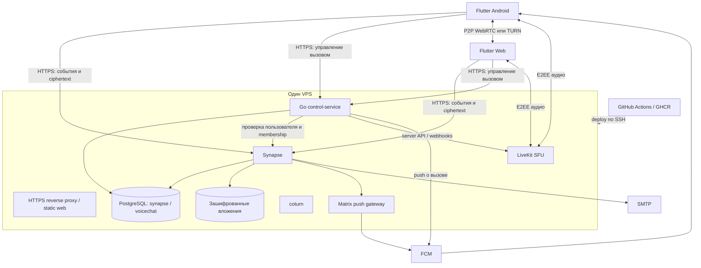

# Компоненты и взаимодействие

## Границы системы



Диаграмма показывает логические связи: внешние HTTPS API проходят через reverse proxy; WebRTC/UDP и TURN используют свои порты. Внешний доступ к PostgreSQL и внутренним административным API закрыт.

## Владение обязанностями

| Компонент | Ответственность | Чего в нём нет |
| --- | --- | --- |
| Flutter UI | Экраны, адаптивная навигация, темы, состояния ошибок | Прямых SQL/API-вызовов из виджетов |
| Matrix adapter | Auth, sync, rooms, timeline, uploads, crypto через SDK | Самодельных алгоритмов шифрования |
| Local data layer | Outbox, кэш, индекс поиска, прогресс синхронизации | Серверной копии открытой истории |
| Call manager | Машина состояний вызова, управление аудио, выбор транспорта | Владения аккаунтом пользователя |
| Android adapter | Core-Telecom, FCM, жизненный цикл, audio focus, Bluetooth | Веб-логики |
| Browser adapter | Разрешения, видимость вкладки, хранилище, микрофон | Обещания фоновой работы как у APK |
| Synapse | Аккаунты, членство, события, зашифрованное медиа, crypto backup | Расшифровки содержимого |
| Control-service | Сеансы вызовов, атомарный ответ, квоты, токены LiveKit, push вызовов | Сообщений чата, медиаключей и паролей пользователей |
| LiveKit | Сигнализация SFU и пересылка медиапакетов | Записи/транскрибации, ключей E2EE |
| coturn | Аутентифицированный relay для недоступного прямого маршрута | Долговременных общедоступных credentials |
| Push gateway | Преобразование Matrix-уведомлений в FCM | Расшифрованного текста сообщений |

Sygnal — кандидат на Matrix push gateway, окончательная совместимость FCM HTTP v1 и конфигурации проверяется в прототипе. Push вызовов отправляет control-service, поскольку зашифрованное событие чата нельзя надёжно классифицировать как входящий звонок на сервере.

## Клиентские модули

```text
app/                   маршрутизация, зависимости, старт/выход
features/auth/         регистрация, вход, устройства, восстановление
features/chat/         список чатов, timeline, composer, поиск
features/rooms/        участники и права
features/calls/        call manager, экраны, уведомления
features/settings/     темы, аудио, хранилище
core/matrix/           адаптер SDK, единственный владелец sync/crypto
core/storage/          кэш, outbox, индекс и очистка
core/calling/          P2P и LiveKit за общим интерфейсом
platform/android/      Kotlin и lifecycle
platform/web/          browser adapters
```

Это план структуры, не существующие каталоги. UI подписывается на локальные проекции. Сетевые ответы обновляют хранилище, затем UI; тяжёлые криптографические операции/индексация не блокируют кадры интерфейса. На вебе один выбранный владелец sync/crypto на профиль; несколько вкладок координируются через поддерживаемую SDK блокировку или вкладку-лидера. Пока это не проверено, вторая вкладка не начинает независимую запись в ту же crypto DB.

## Вход и регистрация

Предлагается стандартный auth Synapse: приглашение ограничивает регистрацию, почта подтверждается, пользователь задаёт username/пароль. Почта не публикуется в каталоге пользователей. Собственный identity provider и Matrix Authentication Service в v1 не нужны, если выбранная версия Synapse поддерживает этот поток.

После входа SDK получает Matrix user_id/device_id и токены. Сначала bootstrap/verification crypto, затем доступ к защищённой истории. Новый непроверенный сеанс может войти в аккаунт, но не должен автоматически получать ключи.

Control-service не доверяет присланным user_id/device_id. При запросе клиент передаёт Matrix access token через TLS; сервис проверяет его через фиксированный локальный Synapse (`account/whoami`) и проверяет членство в комнате через Matrix API. Токен используется только в памяти на время запроса, не логируется и не сохраняется. Вызовы к произвольному homeserver по клиентскому URL запрещены.

Проверку прав выполнять на каждом изменяющем запросе. При недоступности Synapse новые допуски запрещены. Для активных звонков сервис отслеживает membership/device revocations через read-only внутренний адаптер Synapse (observer module → подписанный internal webhook), а периодическая сверка через ограниченный admin API закрывает пропуски. Это адаптер к зафиксированной версии Synapse, не готовая стандартная интеграция; его совместимость — отдельная проверка. Никаких прямых чтений таблиц Synapse.

Администраторские credentials изолируются от публичного обработчика; секреты server-to-server не попадают в Flutter. Клиенты независимо проверяют Matrix membership и доверие устройствам перед выдачей ключей: серверный допуск не является криптографическим доказательством доверия.

## Основные потоки

**Сообщение:** UI → outbox → SDK encrypt → Synapse → sync другого клиента → SDK decrypt → локальная проекция → UI. Backend Go в этом пути отсутствует.

**Изображение/голосовое:** клиент создаёт файл и миниатюру → шифрует → media upload → получает ссылку → отправляет зашифрованное событие с параметрами расшифровки. Получатель скачивает ciphertext и проверяет/расшифровывает локально.

**Уведомление чата:** Synapse → gateway → FCM с минимальными идентификаторами → клиент sync → проверка события → локальное уведомление. Дубликат push не создаёт дубликат сообщения. В фоне можно показать нейтральное «Новое сообщение», если ключи пока недоступны.

**Вызов:** control-service проверяет права и создаёт сеанс → адресные push → устройство проверяет текущее состояние вызова → atomic accept → проверка E2EE → подключение медиатранспорта. Подробности в [calls.md](calls.md).

## Источники

- [Matrix Dart Client API](https://pub.dev/documentation/matrix/latest/matrix/Client-class.html)
- [Matrix push gateway](https://spec.matrix.org/latest/push-gateway-api/)
- [Sygnal](https://github.com/matrix-org/sygnal)
- [Synapse configuration](https://element-hq.github.io/synapse/latest/usage/configuration/config_documentation.html)

Схема сервисов и адаптеры — проектные решения VoiceChat; SDK и спецификации не гарантируют их готовую совместимость.
