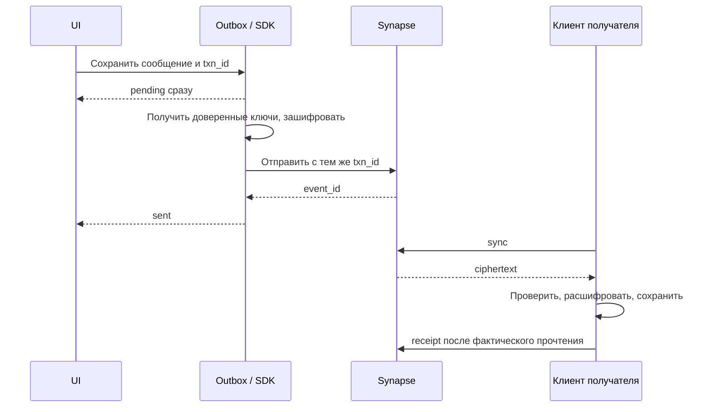

# Хранение данных и синхронизация

## Источники истины

| Данные | Владелец и место | Защита / восстановление |
| --- | --- | --- |
| Аккаунт, password hash, почта, устройства | Synapse / БД `synapse` | Контроль доступа, резервная копия БД; почта видна серверу |
| Членство, роли, настройки комнаты | Synapse / `synapse` | TLS, metadata доступны серверу |
| Текст, edits, ответы | Matrix encrypted events | E2EE, сервер хранит ciphertext |
| Реакции, receipts, typing | Стандартные Matrix события/API | Не считать E2EE; см. security.md |
| Картинки, аудио, previews | Media store Synapse / persistent volume | Шифрование до upload; ключи только в encrypted event |
| Backup ключей | Matrix key backup и secret storage | Только зашифрованные материалы на сервере |
| Сеансы звонков, leases, idempotency | Go / отдельная БД `voicechat` | Только служебные данные, медиаключей нет |
| Push tokens | Synapse pusher и Go device_push | Только нужные сервисы; очистка при logout/invalid token |
| Кэш и поисковый индекс | Устройство | Защита как открытого содержимого, не публичный сервер |
| Темы и аудионастройки | Устройство | Не входят в переписку, перенос опционален |

Один PostgreSQL instance, две БД, отдельные роли. Synapse сам управляет своей схемой; собственные миграции касаются только `voicechat`. Файлы не складываются BLOB-ами в PostgreSQL.

## Логическая модель переписки

Используем Matrix ID как канонические идентификаторы; локальный UI может скрывать доменную часть username. Личный чат также является закрытой Matrix-комнатой. Одновременное создание двух DM допустимо обработать выбором канонической комнаты в клиенте; не обещать уникальность пары пользователей, которой нет в серверной схеме.

| Функция | Представление |
| --- | --- |
| Текст | `m.room.message` внутри encrypted event |
| Изображение | media event с encrypted file descriptor |
| Голосовое | audio event с совместимыми SDK voice-метаданными; профиль фиксируется в прототипе |
| Ответ | relation на исходное событие; не помещать открытый текст цитаты вне шифрования |
| Изменение | replacement event; автор должен совпадать с автором оригинала |
| Удаление | redaction; клиент удаляет из локального индекса и очищает preview |
| Реакция | стандартный `m.reaction`; сервер видит emoji и связь |
| Прочитано | receipt до последнего прочитанного события; для групп UI показывает прочитавших |
| Набор текста | временный индикатор с истечением, throttling, не долговременная история |

Не называем принятие сообщения сервером «доставлено на телефон»: статусы UI различают queued/sending/sent/failed/read. Между sent и read нет выдуманного подтверждения доставки, если SDK его не предоставляет.

## Локальная модель

SDK — единственный владелец crypto store и Matrix sync token. Прикладные таблицы/проекции:

- `outbox`: local_id, txn_id, room_id, payload_ref, state, attempt_count, retry_after, last_error.
- `timeline_projection`: event_id, room_id, sender, effective_body, edit/redaction flags, sort position.
- `search_index`: event_id, room_id, индекс разрешённого расшифрованного текста.
- `media_cache`: ciphertext/ref, размер, last_access, статус; decoded preview по возможности в памяти.
- `sync_progress`: прогресс построения проекций/индекса, не второй независимый Matrix sync cursor.

Outbox и индекс содержат приватные данные и подчиняются общей защите хранилища. Если SDK уже обеспечивает durable outbox, используем его, а не отправляем сообщение двумя независимыми очередями. Для прикладных проекций обработка идемпотентна по event_id; checkpoint сохраняется после обновления проекции. Прерывание между sync SDK и индексацией компенсируется повторным чтением SDK-хранилища.

## Отправка и повторные попытки

После таймаута ответа повторяем с тем же txn_id и сохранённым событием в той же сессии; не генерируем новое сообщение. Backoff с jitter, учитывать rate-limit. Ошибки авторизации не повторять бесконечно. После переустановки/нового access token нельзя автоматически считать серверную дедупликацию старого txn_id сохранённой; неоднозначные pending сверяются либо требуют явного действия пользователя.

Для файлов сначала durable local draft, затем шифрование, upload, затем событие. Успешно загруженный объект повторно используется, если событие не отправилось. Upload может создать orphan; нельзя удалять все «старые файлы» без проверки ссылок. В первой версии автоматическую агрессивную очистку серверного медиа не включаем; квоты/наблюдение и отдельная политика GC после проверки семантики Synapse.

Офлайн-редактирование/удаление/реакции также проходят очередь. Проекция применяет события по правилам протокола, а не только по локальным часам. Если original ещё не загружен, relation хранится до получения оригинала.

## История и поиск

При открытии чата показываем кэш, затем sync и пагинацию назад. Live sync не заменяет загрузку всей истории. Поиск локальный: фоновые порции истории → decrypt → индекс; UI показывает границу проиндексированной истории и ошибки отсутствующих ключей. Полнотекстовый поиск по ciphertext на сервере не используется.

На новом устройстве сначала восстановление ключей; затем загрузка/индексация. Новый участник группы по исходной политике не получает историю до вступления: history visibility и ротация сессий на membership change должны проверяться вместе. Честный клиент не пересылает старые ключи новому участнику; участник, уже прочитавший историю, технически может раскрыть её сам.

В индекс входят актуальные тексты, а не удалённые или заменённые версии. Очистка кэша не удаляет серверную историю. Logout очищает локальные ключи, токены, индекс, drafts, push registration; перед удалением последнего сеанса показывается статус backup.

## Собственная схема звонков (проект)

| Таблица | Основные поля и ограничения |
| --- | --- |
| `calls` | UUID id, matrix_room_id, kind, creator_user_id, state, version, media_generation, created/expires/ended_at; один незавершённый сеанс на комнату |
| `call_members` | call_id, user_id, device_id, state, lease_until; одно выбранное устройство на пользователя |
| `user_call_leases` | user_id PK, call_id, device_id, lease_until; предотвращает одновременный ответ в разные вызовы |
| `device_push` | user_id+device_id, FCM token, updated_at; owner выводится из auth |
| `request_keys` | user_id+device_id+endpoint+idempotency_key, request_hash, result_ref, expires_at |
| `call_events` | call_id+sequence, тип, минимальный payload; для возобновления SSE |
| `notification_outbox` | recipient device, call_id, kind, expires_at, attempts; отправка после commit |
| `processed_webhooks` | provider+event_id unique; защита от повторной обработки |

Изменения calls/leases/events/outbox коммитятся одной транзакцией. Сетевые вызовы LiveKit/FCM выполняются после commit с повтором и идемпотентными job ID. Для create/join/accept используются row locks и ограничения БД, а не проверка численности в памяти.

Исходная retention: call metadata/events 30 дней, idempotency 24 часа, технические логи 7 дней; это настраиваемые проектные значения. Активные leases имеют короткий срок, не удаляются как пользовательская история. Вызовы не записываются. Логи не содержат access token, SDP, ключей, тела сообщений, FCM token или email.

## Источники

- [Matrix client-server specification](https://spec.matrix.org/latest/client-server-api/)
- [Synapse PostgreSQL](https://element-hq.github.io/synapse/latest/postgres.html)

Прикладные таблицы, UX статусов и retention — собственные проектные решения.
