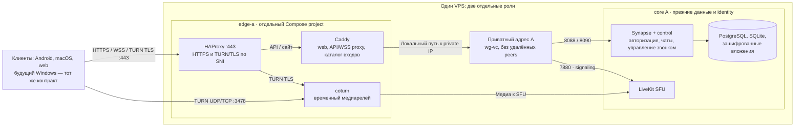
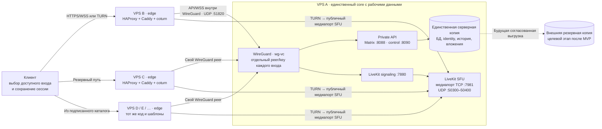
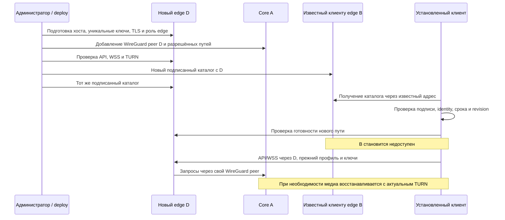

# Сетевая топология VoiceChat: от одного VPS к нескольким входам

28 октября 2026. Схема согласованного решения и локально подготовленного кода;
это не описание уже выполненного production-развёртывания. Основание:
[ТЗ](../three-vps-spec.md), [план](../tasks/19-three-vps.md),
[проверки и ограничения](../iterations/19-three-vps.md).

## Начало: один физический VPS

Один VPS остаётся одной точкой отказа. Разделение ролей готовит последующий перенос,
но ещё не даёт резервирования. Private IP должен существовать даже без удалённых
серверов; два проекта не могут одновременно делить публичные порты со старым
single-host web/TURN. Этот переход требует отдельной миграции.

## После расширения: один core, произвольное число входов

Здесь два разных сетевых пути:

| Что передаём | Путь и защита |
| --- | --- |
| Вход, сообщения, файлы, управление звонком | Клиент → HTTPS edge → WireGuard → API A. Пользовательская авторизация выполняется на A. |
| Сигнализация LiveKit | Клиент → WSS edge → WireGuard → LiveKit на A. |
| Медиа через SFU | Клиент → TURN на доступном edge → публичный медиапорт SFU A. Firewall допускает входы из inventory, прямой доступ клиента к SFU закрыт. Внешний адрес A должен быть доступен самому edge. |
| Личный WebRTC/P2P путь | ICE выбирает прямое соединение участников или TURN. Эти потоки не обязаны проходить через SFU A. |
| Выбор/обновление входов | HTTPS readiness и проверяемый подписанный каталог на известных edge; приватный ключ подписи хранится отдельно. |

В текущем конфиге **TURN→SFU идёт к публичному медиапорту A, не через WireGuard**.
Общий запрет private/metadata peers у coturn сохранён. Закрытый SFU через туннель
потребовал бы отдельно согласованного узкого исключения и медиапроверки; на схеме
такая возможность не выдаётся за реализованную. WireGuard защищает межсерверный
API/WSS участок и не заменяет E2EE пользовательских данных и медиапотоков.

У входов нет рабочих БД и пользовательского media storage. Они имеют только
необходимые своей роли TLS/TURN/tunnel credentials, публичные web/update assets,
каталог и ограниченные служебные логи. B/C/D не зависят от связи друг с другом.
У каждого физического узла свой WireGuard-ключ; `AllowedIPs` ограничены /32.
Список peers не заменяет ACL: фильтр разрешает через туннель только API/signaling,
запрещает транзит в другие сети и учитывает исходный порт до Docker DNAT.
В одноузловой схеме к API допускаются локальные web/health, к медиа — coturn.

## Добавление входа и переключение

Выпуск/распространение каталога и подготовка хоста — отдельные операции. Один новый
IP в конфиге не устанавливает ПО, не выпускает TLS и не создаёт firewall. Конечная
автоматизация должна выполнять эти шаги; её полный rollout ещё не завершён.
Хотя бы один ранее известный клиенту адрес должен оставаться доступен, иначе клиент
не узнает о новом D. Замена C не требует доступа к диску старого C.

## Что уже подтверждено локально

- Один bootstrap entry расширяется подписанным каталогом без новой сборки клиента;
  после отказа старых входов сохранены native Matrix profile и расшифровка файлов.
- Настоящий macOS LiveKit resume и full restart через другой proxy с доставкой
  данных и сохранением key provider. Это не приёмка расшифрованного звука/экрана.
- Настоящие Linux WireGuard B→A/C→A, замена ключа B, отказ старому ключу без restart A,
  сохранение C и приватный адрес единственного A без peers.
- Scoped firewall и его atomic apply/resume прошли локальный Linux kernel fixture:
  INPUT/FORWARD, DNAT, отказ постороннему клиенту/транзиту, совмещённые роли.
- Схемы/генераторы ролей и guarded role manifests. Полный host bootstrap,
  TLS renewal, CI rollout/rollback и production миграция остаются открытыми.

Без внешней копии потеря A означает потерю единственной серверной копии данных.
Дополнительные входы защищают доступность сетевого пути, но не заменяют backup A.
