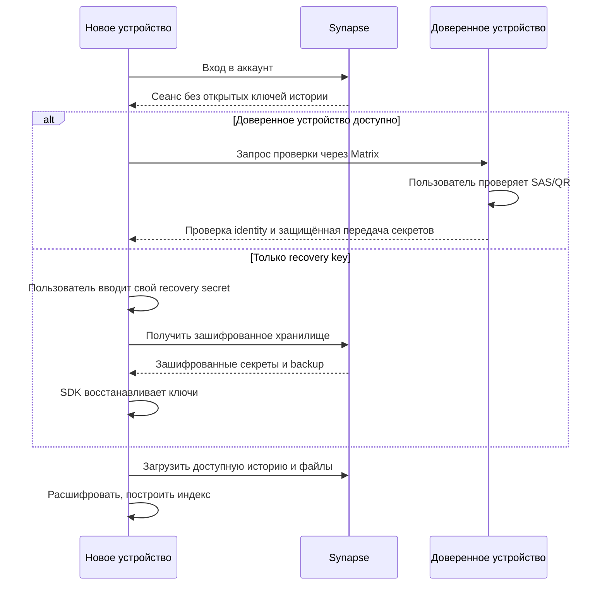

# Шифрование, доверие и восстановление

## Модель угроз и границы

Цель: защита содержимого от наблюдателя сети, утечки диска VPS и серверных компонентов, не имеющих клиентских ключей. HTTPS/WSS обязателен в дополнение к E2EE. Защита от подмены ключей требует проверки идентичностей, а не только наличия значка замка.

Захваченный телефон, вредоносное обновление APK или веб-клиента, XSS и получатель, копирующий сообщения, находятся за пределами гарантий E2EE. Сервер доставки веб-приложения может подменить JavaScript; поэтому безопасность веб-клиента зависит и от доверия к цепочке поставки. Нельзя обещать абсолютную защиту от владельца скомпрометированного веб-сервера лишь наличием E2EE.

Метаданные видны соответствующим серверам: user/device ID, членство, время, размеры событий, IP, служебные статусы; SFU видит подключённых участников и параметры потоков. Почта/username нужны серверу аккаунтов. Прямой P2P раскрывает участникам сетевые адреса друг друга.

## Иерархия ключей

| Материал | Где создаётся/хранится | Назначение |
| --- | --- | --- |
| Device identity и session keys | Matrix SDK, на клиенте | Аутентифицированное шифрование между устройствами |
| Cross-signing keys | SDK на клиенте; зашифрованный secret storage | Связь устройств с идентичностью пользователя |
| Room session keys | SDK на клиенте | Шифрование истории; зашифрованный backup |
| File keys | SDK при upload | Каждый файл/preview шифруется отдельно; descriptor в encrypted event |
| Recovery secret | SDK на клиенте, резервная копия у пользователя | Открытие защищённого хранилища секретов/backup |
| Call media keys | SDK/CSPRNG на клиенте для каждого сеанса/отправителя/эпохи | Временная защита медиапотоков; не включать в историю/backup |
| Synapse signing key | VPS secret | Серверный протокол; не расшифровывает чаты |
| LiveKit API secret / TURN secret | Только нужные серверы | Авторизация транспорта; не E2EE |

Используем Matrix Olm/Megolm через Matrix Dart SDK и vodozemac. Не пишем собственные ratchet, KDF, nonce management или форматы шифрования файлов. Megolm не следует описывать как идентичный Signal Double Ratchet: свойства распространения и ротации групповых ключей отличаются. [Спецификация Megolm](https://spec.matrix.org/latest/olm-megolm/megolm/).

## Политика доверия

1. При первом входе создаём identity, cross-signing и backup с помощью SDK.
2. Свои новые устройства подтверждаются проверенным устройством или восстановленной identity. Не выдаём room keys любому устройству только потому, что оно вошло с паролем.
3. Устройства собеседника должны быть cross-signed его принятой identity. Для первого контакта показываем состояние «Личность не проверена»: принятие первого ключа (TOFU) допускается как исходная UX-политика, но не называется защитой от активной подмены при первом знакомстве. Предлагаем SAS/QR-проверку контакта.
4. Смена уже известной identity блокирует автоматическую выдачу ключей и требует нового подтверждения. Сервер не может сам снять это предупреждение.
5. После отзыва устройства новые сессии/ключи ему не передаются; старое уже полученное содержимое отозвать невозможно.

SDK-политику key sharing проверяем явно, включая восстановление backup: отзыв только Matrix access token не стирает уже скопированные секреты. При подозрении на компрометацию identity/recovery секретов нужен криптографический reset, а не один logout.

## Что защищено E2EE

| Объект | Решение |
| --- | --- |
| Текст, edit, тело ответа/цитата | Шифруются в комнате |
| Изображение, голосовое, thumbnail | Шифруются до upload; размеры/факт загрузки видимы |
| Filename, waveform, caption | По возможности только в encrypted descriptor, не в открытом URL/логе |
| P2P SDP/ICE и проверочные данные звонка | Зашифрованные to-device сообщения, ограниченный срок |
| Групповое аудио | Дополнительный слой LiveKit E2EE; транспортное SRTP до SFU само по себе недостаточно |
| Reaction, typing, receipt, название/состав комнаты | Стандартные Matrix метаданные, не обещать сквозное шифрование |

Последняя строка остаётся вопросом продуктовой приватности. По умолчанию проектируем совместимый Matrix-вариант; если пользователь потребует скрывать также эти данные, нужен отдельный ADR и клиентский протокол. Не выпускать UI с утверждением «сервер не видит вообще ничего».

## Восстановление

После первичной настройки пользователь сохраняет recovery key отдельно от единственного телефона; проверяем сохранение и состояние загрузки backup. При невозможности завершить backup показываем незавершённый статус, а не «история защищена от потери».

Смена пароля аккаунта не заменяет recovery secret. Утрата всех доверенных устройств и recovery secret означает утрату доступа к старой истории, если не осталось иного разрешённого источника ключей. Серверный backup и пользовательский backup ключей восстанавливаются независимо.

## Защита на устройстве

Android: KEK/секрет доступа к crypto store защищён Android Keystore через проверенный адаптер; приватные БД, outbox и search index должны быть зашифрованы at rest. Фактическая связка SQLCipher/SDK database adapter — блокирующая проверка, а не уже выбранная совместимая библиотека. Keystore сам по себе не шифрует автоматически SQLite. Временные plaintext-файлы ограничиваются private cache, очищаются после использования; thumbnails не попадают в общую галерею без явного экспорта.

Web: HTTPS, строгая CSP, ограниченные сторонние скрипты, запрет небезопасного рендера сообщений, отдельный origin приложения. Persistent IndexedDB доступен коду origin и не равен Android Keystore. Для общего компьютера предлагаем сеанс без постоянного сохранения ключей и очищаем память/данные при выходе; утрата browser storage должна восстанавливаться ключом. Offline-кэш приложения не кэширует приватные API-ответы и plaintext медиа.

FCM-пакет не содержит текст, имя звонящего, SDP, ключи или attachment URL с секретом. Для звонка достаточно opaque call_id, типа действия и expires_at. Подлинность/актуальность клиент проверяет запросом к backend, а не доверяет push.

## Проверки безопасности до релиза

- Серверные dumps, логи, push payload и телеметрия не раскрывают содержимое/ключи.
- Непроверенное новое устройство не получает ключи автоматически.
- Смена identity, replay ключевых сообщений, неверный sender/device/call binding приводят к отказу.
- После исключения участника он не расшифровывает новые сообщения/медиа; тестировать реальное сохранение старых токенов и ключей.
- Нельзя отправить сообщение в комнату без включённого E2EE через штатный UI.
- При несовместимости media E2EE не происходит fallback на незашифрованный звук.
- Проверены локальное хранение и supply chain; отдельный review криптографической интеграции до использования для чувствительных данных.

## Источники

- [Matrix encryption API](https://spec.matrix.org/latest/client-server-api/#end-to-end-encryption)
- [Matrix recovery model](https://matrix-org.github.io/matrix-rust-sdk/matrix_sdk/encryption/recovery/index.html) — модель, не контракт Dart API.
- [LiveKit encryption](https://docs.livekit.io/transport/encryption/)

Политика доверия и границы продукта — решения проекта; поддержку каждого сценария конкретным SDK проверяем отдельно.
