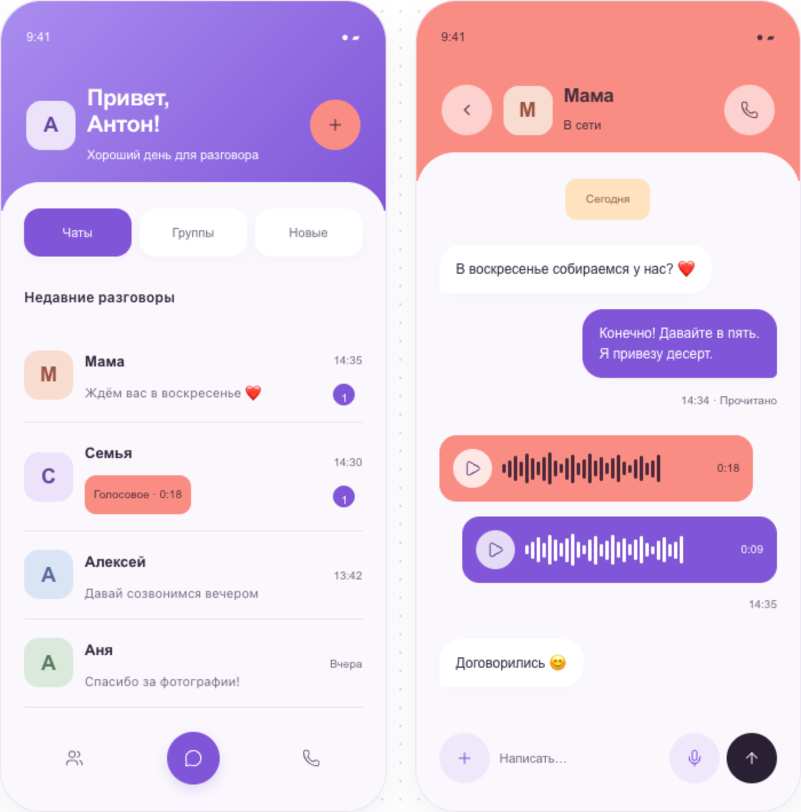

# Визуальное направление: Lavender Soft

Дата выбора: 21 октября 2026. Статус: основной визуальный референс проекта, выбран владельцем.

**Lavender Soft задаёт направление дальнейшего дизайна VoiceChat. Это не финальный макет, не готовая дизайн-система и не требование воспроизвести экраны буквально или пиксель в пиксель.** При проектировании Android, адаптивного веба и будущего iOS нужно развивать этот стиль с учётом сценариев, удобства и платформы.

## Сохранённый референс

- [Предпросмотр в браузере](lavender-soft.html) — только выбранный вариант: список переписок и личный чат. Открывается как локальный HTML-файл; для загрузки иконок может потребоваться интернет.
- [Изображение экранов](lavender-soft.png) — статический снимок для просмотра без запуска HTML.
- [Редактируемый исходник эскиза](lavender-soft.fragment.html) — HTML/CSS/JS, из которого подготовлен предпросмотр. Это иллюстрация направления, а не код интерфейса Flutter.

## Что берём за основу

- Светлый, дружелюбный интерфейс с лавандовым основным акцентом и коралловым дополнительным.
- Цветная верхняя область экрана и светлая основная панель с выразительным скруглением верхних углов.
- Мягкие формы сообщений, аватаров и кнопок; аккуратные тени и умеренные градиенты.
- Голосовые сообщения как заметный элемент переписки: звуковая дорожка, длительность и явная кнопка воспроизведения.
- Спокойные фоновые поверхности и ясная иерархия: имя, содержание, вторичные статусы.
- Отдельные, различимые действия для голосового сообщения и живого звонка.

Цвета эскиза — отправные значения, а не обязательные токены:

| Роль | Цвет |
| --- | --- |
| Основной лавандовый | `#8055D7` |
| Светлый лавандовый / градиент | `#AA8DF0` |
| Коралловый | `#FA8D83` |
| Фон | `#FAF8FD` |
| Поверхность | `#FFFFFF` |
| Основной текст | `#312940` |
| Вторичный текст | `#736A81` |

## Что проектируем дальше

### Предварительные дополнительные темы

Отдельно выбраны четыре [предварительных морских референса](sea-themes/README.md): **Лагуна, Коралловый риф, Биолюминесценция и Закат в бухте**. Они не являются основными и не заменяют Lavender Soft. Там же зафиксирована идея возможных фоновых анимаций (пузырьки, капли и другие мягкие эффекты); сейчас только как пожелание, без демонстраций или обязательства реализации.

Компоновка, навигация, шрифты, размеры, отступы, радиусы, иконки, тексты и расположение действий могут меняться. Не нужно переносить мелкий текст и размеры элементов из демонстрации в приложение без проверки читаемости, контраста, масштабирования текста и удобства нажатия.

Веб на компьютере должен получить подходящую широкому экрану компоновку, а не растянутую копию телефона. Состояния загрузки, ошибок, офлайна, записи аудио, восстановления связи, входящие и групповые звонки, поиск, вложения, настройки и доверенные устройства требуют отдельного проектирования. Тёмная и другие цветовые схемы должны развивать выбранный стиль; показанные ранее альтернативы автоматически не считаются выбранными темами.

Демонстрационные контакты, сообщения, статусы и реакции кнопок не определяют продуктовую логику. Функциональный объём задают [требования](../requirements.md), технические ограничения — [архитектура](../architecture/README.md). Этот референс определяет визуальный характер, но не меняет их.

## Происхождение

Выбран вариант **Lavender Soft** из пяти эскизов, созданных в обсуждении VoiceChat по предоставленному владельцем изображению «Voice Chat App UI Kit». В репозитории сохранён выбранный эскиз без остальных вариантов. Логотип и изображения людей из исходной картинки в него не перенесены.

Текущее состояние адаптивной веб-версии в итерации 3 (тестовые данные): [десктоп](screenshots/core-web-desktop.png), [телефонная ширина](screenshots/core-web-mobile.png). Это снимки реализации, отдельно от исходного референса.

Интерфейс переработан в [итерации 4](../iterations/04-web-session-and-lavender.md): [вход](screenshots/lavender-welcome.png), [десктоп](screenshots/lavender-desktop.png), [телефонная ширина](screenshots/lavender-mobile.png). Предыдущие снимки итерации 3 сохранены как история реализации.
