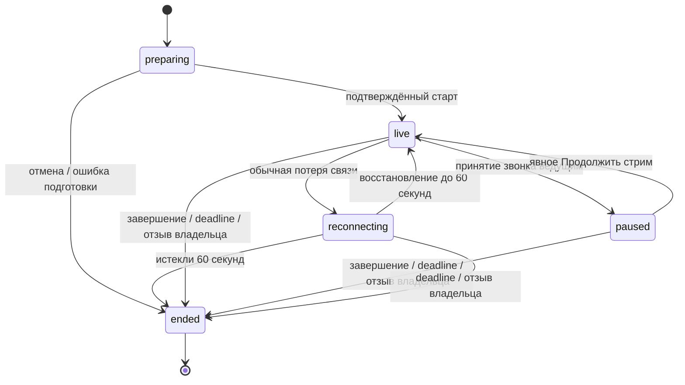

# Техническое задание: стримы VoiceChat без сохранения

Версия 1.0 — 1 ноября 2026. **Только проектирование. Реализация не начата.**
Основание: согласованные в чате проекта требования владельца 01.11.2026.
[План исполнения](tasks/live-streams.md) · [Единый реестр приёмки](user-acceptance.md).

## 1. Назначение и границы

Любой зарегистрированный пользователь запускает живой эфир для друзей из
обычного VoiceChat, без создания звонка. Друзья видят доступный им эфир на аватарке,
открывают информацию, смотрят и комментируют. Аудио/видео не записываются;
текстовый чат существует только во время эфира, включая историю для позднего входа.

Документ задаёт конечный результат и технические контракты. Согласованные
пользовательские требования имеют ID STR-01–18. Инженерные решения ниже — проектные
решения для реализации; их можно уточнять по результатам проб, сохраняя требования.
Неподтверждённые возможности платформ отмечены как обязательные контрольные точки,
а не как реализованные или автоматически допустимые исключения.

### 1.1. Этапы глобальной задачи

| Этап | Обязательный результат | Граница |
| --- | --- | --- |
| MVP | Камера, Android APK и iPhone Safari/PWA, до 10 зрителей, все STR-01–18 в объёме MVP | iOS-приложение не разрабатывать; поддержка фона не обещана |
| Целевой: desktop | Полный сценарий ведущего/зрителя на macOS и Windows | Windows зависит от готового клиента и его распространения; браузер не выдавать за нативный клиент |
| Целевой: источники | Камера, экран, камера вместе с экраном | Возможности захвата проверять на каждой платформе; не обещать мобильный web-захват без доказательства |
| Целевой: уведомления | Уведомления допущенным друзьям о начале эфира, безопасный переход к нему | Реальная доставка в заявленных состояниях приложения; никаких уведомлений посторонним |
| Будущий нативный iOS | Тот же функционал стримов в будущем iOS-клиенте | Внешняя зависимость от отдельной задачи создания iOS-клиента; сейчас не начинать |

MVP не включает гостей интернета, публичный каталог, монетизацию, расписание
будущих эфиров, запись, архив, перемотку, скачивание, со-ведущих, ручное исключение
зрителей, редактирование параметров эфира после старта, перенос ведущего между
устройствами. Эти функции не появляются автоматически на целевом этапе.
Кнопки камеры/микрофона, качество и ручное продолжение после звонка — разрешённое
оперативное управление, а не редактирование аудитории/названия/срока.

## 2. Согласованные функциональные требования

| ID | Требование |
| --- | --- |
| STR-01 | До запуска задать название и описание. В информации показывать фактическую дату и время начала эфира и заданную длительность, если она есть. Время начала берётся из серверного состояния, отображается в часовом поясе зрителя; планирование будущих эфиров этим требованием не вводится. |
| STR-02 | До запуска разрешить или запретить комментарии в реальном времени. Только текст и эмодзи; ведущий тоже может писать. При запрете отправка закрыта всем, включая ведущего. Без вложений, реакций, редактирования и удаления отдельных комментариев. Зритель может читать чат. |
| STR-03 | Качество выбирают и могут переключать во время эфира ведущий и каждый зритель: несколько уровней и «Авто». Переключение не завершает эфир и не сбрасывает чат; ведущий меняет качество публикации, зритель — качество собственного просмотра в пределах доступного потока. Выбор зрителя не меняет качество у остальных; недоступное разрешение не обещать. Конкретные разрешения/FPS/битрейты определить по испытаниям телефонов. |
| STR-04 | Максимальная длительность любого эфира задаётся серверной property: **3 часа (10 800 секунд)** в MVP. Ведущий может выбрать меньшую длительность или не задавать свой таймер; прежнее «Без ограничений» означает только отсутствие собственного таймера, серверный предел действует всегда. В интерфейсе явно показывать максимальный срок, не обещать бесконечный эфир. Эффективная длительность — выбранная длительность, но не больше серверного максимума; без выбора — серверный максимум. Показывать её в информации и прогресс-бар прошедшего времени относительно эффективной длительности с текстовым временем. При позднем входе/переподключении восстанавливать прогресс по серверному началу. Это индикатор времени, не перемотка видео. Сервер самостоятельно завершает эфир по достижении срока; ведущий может закончить раньше. |
| STR-05 | Настроить видимость и возможность входа: всем друзьям либо выбранным друзьям. Закрытый эфир, его значок и информация видны только выбранным друзьям; остальные не могут открыть карточку или присоединиться, в том числе по прямому идентификатору. «Для всех» не означает всех пользователей сервиса или гостей интернета. |
| STR-06 | На аватарке ведущего в списке друзей показывать анимированный значок broadcasting/эфира. По нажатию доступны информация и переход к просмотру. Учитывать reduced motion, дать статическое обозначение и доступное название. |
| STR-07 | Допущенный зритель присоединяется к текущему эфиру, смотрит видео и чат, отправляет разрешённые комментарии, выходит и возвращается, пока эфир активен. После завершения повторное открытие показывает завершённый статус, без воспроизведения записи. |
| STR-08 | Во время эфира ведущий может выключать и включать свой микрофон: при выключении его не слышит никто из зрителей. Каждый зритель независимо выключает и включает звук просмотра только у себя, не меняя микрофон ведущего и звук остальных зрителей. |
| STR-09 | На телефоне во время эфира переключать фронтальную и заднюю камеру, как в видеозвонках. Сохранять эфир, зрителей, чат и состояние микрофона; при недоступной камере показывать ошибку без ложного успешного переключения. В MVP также нужна отдельная кнопка выключения/включения камеры: при выключении видео не передаётся, зрителям показывается заглушка вместо последнего кадра, а звук продолжает идти, если микрофон включён. Эфир, чат, зрители и таймер сохраняются; это не пауза при звонке и не обрыв с отсечкой 60 секунд. Повторное включение камеры не меняет состояние микрофона. |
| STR-10 | **Стримы нигде не сохранять средствами приложения:** без записи аудио/видео, архива, перемотки, скачивания, thumbnails из кадров и фонового накопления медиа на диске. Цель — не раздувать хранилище. |
| STR-11 | **Чат исчезает после завершения эфира.** Не сохранять сообщения в постоянной Matrix-истории, локальной истории, офлайн-очередях, логах или резервных копиях. Поздно вошедший допущенный зритель видит предыдущие комментарии с начала текущего эфира. История существует временно только во время эфира; завершение очищает её у всех клиентов и в сервисе. Обеспечить восстановление истории при повторном входе в ещё активный эфир без дублей и нарушения порядка. Лимиты памяти/сообщений и поведение при их достижении согласовать до реализации; не подменять полную историю молчаливым удалением старых комментариев. |
| STR-12 | После остановки/истечения срока убрать индикатор у друзей, закрыть допуск и публикацию, освободить камеру/микрофон, уничтожить временный чат и ключи эфира. При обрыве отличать переподключение от завершения; зависший эфир не остаётся активным бесконечно. |
| STR-13 | Один активный эфир на пользователя. Один зритель смотрит конкретный эфир с одного устройства на аккаунт; максимум 10 зрителей без ведущего. Одиннадцатому показать «Все места заняты», без очереди. Повторные запросы и переподключения не создают дополнительные места или второй эфир. |
| STR-14 | При обычном обрыве передачи ведущего ждать восстановления до 60 секунд, зрителям показывать «Ведущий переподключается». Если передача не восстановилась — завершить эфир и удалить чат. Общий таймер не останавливается. |
| STR-15 | В MVP ведущий держит приложение открытым; во время трансляции предотвращать автоматическое гашение экрана доступными средствами платформы. Если фон/блокировка остановили передачу, применять STR-14, кроме явно установленной паузы STR-16. Не обещать фоновую камеру там, где её не допускает ОС/браузер. |
| STR-16 | Принятие звонка ведущим переводит эфир **на паузу**, не завершает его. Прекратить передачу камеры и микрофона до передачи их звонку; у зрителей вместо видео (включая последний кадр) показывать «Стрим на паузе», без звука. Эфир, зрители и временная история чата сохраняются; общий таймер и прогресс продолжаются. После звонка камера и микрофон не возобновляются автоматически: ведущий возвращается в эфир и нажимает «Продолжить стрим». К явно установленной паузе не применять отсечку обычного обрыва в 60 секунд: пауза может длиться до общего deadline, после которого продолжить уже нельзя. Само входящее приглашение не ставит эфир на паузу. При принятии звонка зрителем прекращается его просмотр, эфир остальных продолжается. |
| STR-17 | Ведущий видит список и количество зрителей; зрители — количество и авторов комментариев. Удаление из друзей или блокировка автоматически прекращают доступ к эфиру и будущему медиа/чату, независимо от отсутствия ручного исключения зрителей в MVP. |
| STR-18 | В MVP обнаружение эфира — значок у друга и карточка информации. Без push и автоматических сообщений друзьям. Уведомления о начале эфира входят в целевое развитие с соблюдением аудитории закрытого эфира. |

## 3. Пользовательские сценарии и интерфейс

### 3.1. Подготовка и запуск

1. Пользователь открывает «Начать стрим». Проверяется отсутствие его другого
   активного/приостановленного эфира и возможность выделить ресурсы сервера.
2. Форма: название, описание, комментарии, аудитория (все друзья/выбранные друзья),
   длительность до серверного максимума, качество с «Авто». Камера — предпросмотр
   с переключением сторон и явными состояниями микрофона/видео.
3. Проектные безопасные значения: качество «Авто», микрофон/камера включены после
   разрешения пользователя, комментарии включены; аудиторию подтвердить явно,
   не публиковать скрыто для всех при пропущенном выборе. Название обязательно,
   описание необязательно. Пустой список выбранных друзей — ошибка формы.
4. После разрешений и подготовки медиатранспорта явное «Начать стрим» фиксирует
   серверное начало и deadline. Не показывать broadcasting до подтверждения старта.
   Повтор кнопки/HTTP retry не создаёт второй эфир. Отмена освобождает устройства.
5. Отказ камеры/микрофона, недоступность сервера, превышение лимита и отсутствие
   доверенного устройства показываются понятными ошибками. Черновик формы не
   является активным эфиром; никакой скрытой публикации после reload.

### 3.2. Обнаружение и вход

- Значок broadcasting — анимированная накладка/рамка на существующей аватарке,
  не замена загруженного фото и не видеопревью. Reduced motion даёт статичный знак.
- Закрытый эфир не раскрывает даже факт существования невыбранным друзьям через
  список, карточку, API, push, счётчик либо различимые ошибки прямого запроса.
- Карточка: ведущий, название/описание, дата/время начала, эффективная длительность,
  прогресс, состояние и кнопка входа. Формат времени локальный, расчёт серверный.
- Подключение зрителя никогда не запрашивает камеру/микрофон. Автовоспроизведение
  звука подчиняется платформе; при блокировке показывать явную кнопку включения.
- После допуска сначала синхронизируются состояние, ключи и история чата, затем
  подключается живое обновление без пропусков/дублей. История доступна и при паузе.
- Занято 10 мест — «Все места заняты», без очереди. Второе устройство аккаунта
  получает «Эфир уже открыт на другом устройстве» без принудительного перехвата.
  После выхода/истечения lease повторный вход допустим.

### 3.3. Просмотр и ведение

Ведущий: микрофон, камера on/off, фронтальная/задняя, качество, чат, список и число
зрителей, дата/таймер/прогресс, «Завершить стрим». Зритель: видео/заглушка, локальный
звук, качество, чат, количество зрителей, информация и «Выйти». Полный список
зрителей возвращается только ведущему; автор комментария виден читателям чата.

При выключенной камере показывать заглушку, не замороженный последний кадр.
При mute ведущего не воспроизводить старый аудиобуфер. Ни одна из этих операций
не меняет состояние другой. Одновременный mic off + camera off также допустим:
это активная сессия с heartbeat, не потеря сети. Качество и камера не сбрасывают чат.

Кнопки и состояния доступны screen reader, с клавиатуры на web/desktop, при
крупном шрифте и узком экране. Анимация не единственный носитель live-статуса.
Чат и кнопка завершения не скрываются мобильной клавиатурой. Ротация телефона
не пересоздаёт эфир. Выход ведущего из интерфейса не должен скрыто оставлять захват:
показывать активный статус и доступное возвращение/завершение в рамках приложения.

### 3.4. Звонок и пауза

При принятии звонка ведущим сначала останавливается публикация обоих источников,
затем камера/микрофон передаются звонку. У зрителей заглушка «Стрим на паузе».
Публикация звука разговора в эфир запрещена, даже при ошибке сигналинга.
Чат остаётся доступен согласно первоначальному разрешению комментариев.

После окончания звонка ничего не включается автоматически. Ведущий открывает
эфир и нажимает «Продолжить стрим»; восстанавливаются выбранные до паузы mic/camera,
сторона камеры и качество, повторно проверяются разрешения/срок/допуск устройства.
Если ресурсы заняты либо срок истёк — продолжение не происходит, причина видна.
Пауза не продлевает deadline и не попадает под обычный 60-секундный timeout.

События звонков внутри VoiceChat управляемы приложением. Определение принятого
системного/чужого звонка особенно в iPhone web/PWA — ранняя техническая проверка.
Нельзя молча заменить требуемую паузу завершением через 60 секунд или автоматическим
возобновлением камеры. Если платформа не даёт необходимого сигнала, результат
пробы и конкретный альтернативный сценарий вынести владельцу до интеграции.

## 4. Состояния, время и конкурентные действия

`ending` может быть внутренним состоянием очистки: внешне эфир уже недоступен,
новые grants запрещены, остаточные SFU-ресурсы удаляются с безопасным повтором.
`ended` терминален: старые команды, токены и backup не воскрешают сессию.
Подготовка ограничена временем; не держать бесконечную блокировку аккаунта.

- Сервер задаёт `started_at`, `ends_at`, `revision` и `server_now`. Максимум —
  property `STREAM_MAX_DURATION_SECONDS=10800` (проектное имя). Положительное целое,
  валидация при загрузке конфигурации. Выбор сверх максимума отклоняется с лимитом.
- Deadline фиксируется при старте как начало + выбранная/максимальная длительность.
  Изменение property действует на новые эфиры; клиенты получают итог через API.
- Прогресс = прошедшее / эффективная длительность, ограниченный [0, 1]. Локальные
  часы не источник допуска. Смена времени телефона/reload/reconnect не продлевает эфир.
- Состояния переходят атомарно по ожидаемой revision и idempotency key. Команды
  stop/deadline/revoke имеют приоритет над запоздавшими resume/join/publish.
- Переподключение не создаёт новый отсчёт 60 секунд на каждом повторе запроса.
  Короткий возврат одного heartbeat без восстановления транспорта не бесконечно
  продлевает сессию; intentional mute, camera off и paused учитываются отдельно.
- Зрительские подключения имеют короткие lease; повтор со своего устройства
  обновляет существующее место. Проектный предел освобождения мёртвого места —
  60 секунд, точные heartbeat/lease подобрать по фоновой работе и нагрузке.
- При полном restart control временный чат потерян: базовое инженерное решение —
  закончить прежние эфиры, отозвать SFU поколения и очистить их, не возобновлять
  «тот же эфир» с пропавшей историей. После восстановления пользователь запускает
  новый эфир явно. Обычный reconnect клиента историю не уничтожает.
- Падение SFU при живом control: безопасное восстановление с новым поколением и
  rekey только в оставшемся окне восстановления; иначе завершение. При невозможности
  доказать прежние права — прекратить передачу, без незашифрованного fallback.

## 5. Доступ, ключи и отсутствие сохранения

### 5.1. Авторизация

Источники истины — существующие аутентификация, устройства, дружба и блокировки.
Проверка нужна для обнаружения, карточки, входа, истории, комментариев, ключей,
выдачи/обновления SFU JWT, pause/resume/stop. Доверять заявленному client role нельзя.

Для режима выбранных друзей список фиксируется при старте; действующая дружба
и отсутствие блокировки обязательны всё время. Для «всех друзей» инженерное
правило — проверять текущую дружбу: новый друг тоже может войти, удалённый теряет
доступ. Это следствие выбранной политики, не UI редактирования аудитории.
При недоступности проверки не продлевать привилегии бесконечно; ограниченный
кеш проверенного допуска и fail-closed по его истечении.

Ведущий публикует только разрешённые camera/microphone tracks, зритель не публикует
медиа. Отдельные непрогнозируемые SFU room/generation и opaque identity, без имён,
названий или Matrix ID в инфраструктурных идентификаторах. Чат идёт через
авторизованный control-путь, без произвольного SFU data-publish от зрителя.
Проверить реальный обход canPublish/source/room и повтор JWT на закреплённом SFU.

Отзыв дружбы, блокировка или устройства прекращают будущую доставку и ключи.
Нельзя считать истечение JWT или RemoveParticipant доказанным отзывом действующей
сессии. Переиспользовать проверенный механизм поколений/закрытия комнат и rekey;
если он прерывает других зрителей, сохранить UI/чат и восстановить только допущенных.
При отзыве ведущего закончить эфир. Позднее присоединение на паузе может ждать
выдачи ключа владельцем; нельзя раскрыть ключ серверу ради удобства.

### 5.2. E2EE

Медиа шифруется на клиенте до SFU; комментарии — до control. Использовать
существующие проверенные crypto-примитивы и канал доверенных устройств, не свою
криптографию. Поздним допущенным зрителям нужен доступ к истории текущего эфира;
отозванным — запрет доступа к будущим сообщениям. Это разные задачи rekey.
До основной реализации выполнить пробу выдачи исторических ключей при позднем
входе, паузе владельца и отзыве. Не записывать ключи эфира в долговременный vault,
Matrix room history, журналы или backup; переиспользуемый to-device канал проверить
на TTL/cleanup и совместимость с этим ограничением.

Потеря всех пригодных клиентских ключей или источника истории не исправляется
хранением plaintext на сервере: завершить эфир с понятной причиной либо согласовать
иной протокол до реализации. Автоматическая проверка должна показать получение
реального кадра/аудио с ключом и невозможность расшифровки без правильного ключа.

### 5.3. Жизнь данных

| Данные | Где существуют | Когда исчезают |
| --- | --- | --- |
| Аудио/видео | Ограниченные транспортные/декодирующие RAM-буферы | При остановке треков/выходе; никаких файлов/egress |
| Комментарии | Зашифрованная история в RAM control; расшифрованное представление в RAM допущенных клиентов | Конец/отзыв/выход клиента, restart control завершает сессию |
| Ключи эфира | Память допущенных клиентов; ограниченные по времени защищённые конверты | Завершение/отзыв; не постоянная история |
| Служебные данные активной сессии | Существующее control-хранилище, только необходимое для допуска/recovery | После terminal cleanup и ограниченного окна повторов |
| Название, описание, аудитория | Минимально необходимое состояние эфира | Удалить по завершении; не делать публичный архив |
| Технические метрики | Агрегаты, безопасные коды ошибок и opaque IDs | По существующей политике ротации проекта |

Служебная запись для удаления SFU после crash может жить дольше эфира; она не
содержит контент. До реализации зафиксировать TTL tombstone/idempotency/metadata,
и что попадает в backup. Предпочитать минимальную запись generation/deadline/status,
а пользовательские описания держать временно. Restore не возобновляет эфиры.
Не логировать bodies, JWT, ключи, комментарии, медиа, кадры или приватный roster.
Проверить proxy buffering/temp files, error reporting, SQLite WAL, service worker,
IndexedDB/SQLCipher, браузерный кеш, обычный recorder звонков и диагностические дампы.
API с приватным состоянием/историей — `Cache-Control: no-store`.

Нельзя гарантировать стирание копий у злонамеренного зрителя или системного swap.
При потере связи клиент скрывает содержимое по истечении lease/срока, не ждёт
бесконечно события завершения. Продукт не предоставляет экспорт или запись.

## 6. Чат: порядок, поздний вход и предел памяти

Базовый вариант для MVP — временный зашифрованный буфер в существующем control,
без отдельного брокера, Redis, постоянных Matrix-сообщений или нового хранилища.
Это проектный вариант, подлежащий криптографической и нагрузочной пробе.

Сообщение: stream ID, generation/key epoch, уникальный client message ID,
server sequence, автор/устройство из аутентификации, server timestamp, ciphertext
и необходимые crypto-поля. Сервер ограничивает размер envelope, частоту и членство;
клиент проверяет расшифровку, автора, текстовый тип, длину и валидность содержимого.
Отрисовка как текст, без HTML и автоматических внешних превью/запросов.

При входе история читается порциями до фиксированного `history_head`; далее
сообщения с sequence > head. События, пришедшие во время snapshot, не теряются.
ACK отправки возвращает присвоенный sequence; retry того же ID не дублирует текст,
изменённое содержимое с тем же ID отклоняется. Офлайн-долговременной очереди нет;
неотправленное после конца эфира не попадает в следующий эфир.

Размер истории рассчитывать до старта: максимум сообщений за 10 800 секунд ×
ограничение ciphertext × число разрешённых параллельных эфиров, плюс ключевые
конверты и накладные расходы. Лимит на пользователя должен быть связан с аккаунтом
в рамках эфира, а не сбрасываться сменой устройства; нужен также общий лимит эфира,
чтобы смена состава зрителей не обходила бюджет. Ограничение частоты срабатывает
до принятия сообщения и показывает понятную задержку повтора. Принятые сообщения
не выбрасывать ради новых. При аварийном исчерпании ресурсов прекращать приём
новых сообщений с явной ошибкой, сохраняя доступную историю; измерить этот путь.

## 7. Качество и ресурсы телефона

Переиспользовать существующий `VideoQuality` как исходные профили для пробы:

| Профиль | Текущая база проекта, не обещание результата на всех устройствах |
| --- | --- |
| Низкое | 320×180, до 15 fps, ориентир 150 кбит/с |
| Среднее | 640×360, до 24 fps, ориентир 500 кбит/с |
| Высокое | 1280×720, до 30 fps, ориентир 1,5 Мбит/с |
| Авто | Адаптация в пределах поддерживаемых слоёв и возможностей источника |

При фиксированном качестве ведущего всё равно нужны доступные нижние слои для
зрителей. Не копировать текущую настройку «simulcast только в auto» без проверки:
она может сделать независимый выбор зрителей невозможным. SFU пересылает слои,
а не создаёт более высокое качество, чем публикует ведущий. Выбор зрителя —
предпочтение/верхний предел, с явным снижением при ограничении сети или источника.
Если SDK не совмещает manual selection и adaptiveStream, реализовать явные режимы
и проверенный переход; не показывать работающую настройку без изменения потока.

Для низкой пропускной способности сохранять аудио при возможности; качество
не должно тайно включать выключенную камеру. Измерить switch camera, re-publish,
краткие отказы разрешений, поворот, динамик/наушники и батарею. Кодек/слои выбрать
по пересечению реально поддерживаемых Android/iPhone web и E2EE, не по новейшим docs.

## 8. Серверные контракты и интеграция

Имена маршрутов/классов проектные: при реализации следовать существующему стилю.
Все операции относятся к отдельному эфиру, не требуют активной Matrix-комнаты звонка.

| Операция | Вход / результат | Обязательная проверка |
| --- | --- | --- |
| capabilities | Версия протокола, enabled, максимум длительности, профили/лимиты | Не выдавать приватные эфиры/ключи |
| prepare/start | Настройки, request ID → stream ID/state/revision/times | Пользователь/устройство, единственный эфир, ресурсы, валидность аудитории |
| discover/info | Доступные эфиры/карточка | Текущая дружба/выбор/блокировка; без утечки скрытых |
| join/renew/leave | Device lease → viewer role, snapshot, допуск к ключам/SFU | 10 мест, одно устройство, повтор/idempotency |
| media grant | Session/generation/revision → короткий JWT | Активное право и точные sources/role; paused не даёт publish |
| pause/resume/stop | Request ID, expected revision → state | Только устройство ведущего, deadline, ordering |
| heartbeat/state | Lease + cursor → server state/revision/time | Не заменяет проверку действительного транспорта |
| send comment | ID, envelope → ACK/sequence | Permission, rate/size, current membership, epoch |
| history/events | Cursor/head → страницы/изменения | Авторизация каждой порции, не постоянный replay после конца |

Идемпотентность ограничена сессией и устройством; ошибки различимы для клиента
(занято, полный эфир, завершён, конфликт revision, rate limit), но скрытые эфиры
для постороннего неотличимы от недоступных. Для списка зрителей role-filtered DTO.
Валидация размеров/типов/диапазонов до обработки криптографического тела.

### 8.1. Реальные точки переиспользования

| Область | Существующие файлы | План изменения |
| --- | --- | --- |
| Медиатранспорт и E2EE | `apps/client/lib/call_probe.dart`, `routed_livekit_engine.dart` | Использовать проверенный transport/key flow; не делать стрим поддельным звонком |
| Камера и качество | `camera_capture*.dart`, `call_quality.dart`, `macos_camera.dart` | Переиспользовать захват/профили, не ломать вызовы `VoiceCall` |
| Приём звонка | `call_controller.dart`, `direct_call.dart`, `group_calls.dart`, `call_audio*.dart` | Согласовать ресурсы и pause/resume; найти все места accept через rg |
| Друзья/аватары | `contact_service.dart`, `people_picker.dart`, `avatar_image.dart`, `speaking_avatar.dart` | Разрешённые статусы стримов и отдельный индикатор |
| Серверный доступ | `prototype/token_server.py`, `prototype/contact*.py` | Использовать аутентификацию/дружбу, отдельные stream grants |
| Надёжные переходы | `prototype/screen_control.py`, `screen_transitions.py`, `screen_http.py` | Переиспользовать подход к поколениям/recovery без расширения правил экранных звонков |
| Экран для целевого этапа | `screen_controller.dart`, `screen_capture*.dart`, native adapters | Повторно использовать захват, отдельный lifecycle стримов |
| Выпуск | `infra/configure.py`, `infra/supervise.py`, `.github/workflows/deploy.yml` | Настройки, startup cleanup, штатный release/rollback |

Новые модули создавать только по реальным ответственностям: server session/store,
API, временный чат; client controller/API, экран и UI. Не вводить общий framework
для всех звонков/стримов и не переписывать существующий transport без необходимости.
Изменения схемы additive, versioned, transactional. Проверить rollback совместимости;
если старая версия не понимает новые активные сессии, сначала закрыть их и выключить
функцию штатно. Не изменять ключи аккаунтов, историю переписки, IDs устройств.

## 9. Проверки и критерии качества

Это технические критерии для исполнителя, не отдельный реестр пользовательской
приёмки. Статусы, версии, устройства, даты и результаты пользователя — только
в [docs/user-acceptance.md](user-acceptance.md), строка STR с детализацией при выпуске.

| ID | Проверка и ожидаемый результат |
| --- | --- |
| STR-A01 | Создание/отмена/повтор и гонка двух устройств: один эфир, без скрытой камеры после отмены |
| STR-A02 | Все друзья/выбранные/посторонний/прямой API: нет утечки закрытого эфира и обхода допуска |
| STR-A03 | 10 зрителей + ведущий, 11-й отказ; две вкладки/устройства, retry/lease expiry не обходят лимит |
| STR-A04 | Зритель не публикует camera/mic/screen/data; неверный source/роль/JWT не проходит реальный SFU |
| STR-A05 | Реальные E2EE video/audio/chat, wrong/missing/revoked key не расшифровывает; проверка после rekey |
| STR-A06 | Front/back, mic/camera independently, оба off >60 секунд: эфир жив, нужный звук есть, выключенных кадров нет |
| STR-A07 | Ведущий и разные зрители меняют все качества/auto, фактические слои меняются; чат и эфир сохраняются |
| STR-A08 | История позднему/повторному входу, snapshot+live race, dedup и авторство; выключенные комментарии не обходятся |
| STR-A09 | Короткий обрыв → восстановление; непрерывный обрыв 60 секунд → конец; локальные часы не влияют |
| STR-A10 | Принятый звонок → оба media off, пауза >60 секунд, без утечки разговора; только ручной resume с прежними mute/camera |
| STR-A11 | Deadline 3 часа/меньше, в том числе paused/reconnecting, stop/resume race, обновление property только новым |
| STR-A12 | Удаление дружбы/блокировка/отзыв device: старые JWT/ключи/повтор подключения не дают будущий контент |
| STR-A13 | Crash control/SFU, restart/restore: нет воскресших эфиров, потерянная история не выдаётся за полную, cleanup повторяем |
| STR-A14 | Нет медиа/чата в файлах, кешах, логах, backup и recorder; память освобождается после циклов и длинного эфира |
| STR-A15 | Реальный Android и iPhone Safari/PWA: permissions, поворот, фон/lock, вызов, динамик/наушники, wake lock, доступность |
| STR-A16 | Старый/новый клиент, обычные личные/групповые звонки, экран, сообщения, запись звонка не регрессируют |
| STR-A17 | Нагрузка 10 получателей, несколько эфиров, долгий прогон до 3 часов; лимиты измерены, соседние сервисы здоровы |
| STR-A18 | Exact release source/digests, каналы обновлений, реальное обновление с сохранением аккаунта/истории и rollback |

Unit-тесты с управляемыми часами проверяют все time/race ветки без ожидания часов.
Отдельный длинный прогон нужен для памяти/нагрева, его нельзя заменить clock mock.
Синтетические камеры/эмуляторы не закрывают физическую приёмку. Секреты и реальный
контент друзей не использовать в fixtures. UI/сеть тестировать на одноразовых
аккаунтах; агент самостоятельно готовит окружение и доступные проверки.

## 10. Целевой функционал после MVP

### 10.1. Desktop и несколько источников

Mac и Windows получают те же STR-01–18 с desktop-выбором камеры/микрофона и
адаптивным расположением чата/видео. Windows зависит от отдельной платформенной
задачи; выпуск native включает установку, подпись по правилам платформы и обновления.

Выбор источника: камера, экран или оба. Для «оба» — два независимых видеотрека,
экран основной, камера отдельным блоком; выключение одного не завершает другой.
Разрешения screen capture всегда по явному действию. Отмена системного выбора
не публикует другой экран, системный Stop останавливает только screen track.
Пауза при звонке останавливает все источники; после неё возобновление экрана
подчиняется обязательному повторному разрешению ОС. Аудио устройства/вкладки
не добавлять автоматически: пока согласованы микрофон и управление им.
Проверить E2EE каждого источника, лимиты публикации, качество двух треков,
нагрузку/композицию на получателе и недоступные комбинации на мобильных платформах.

### 10.2. Уведомления

Уведомление только после подтверждённого старта и только допущенным друзьям,
без дубля при reconnect/resume/retry. Политика получения учитывает существующие
настройки пользователя и разрешения ОС. Payload минимальный: не включать закрытое
описание/roster/текст чата. По нажатию заново проверить доступ и состояние; после
конца показать завершение, после отзыва — недоступность без раскрытия информации.
Использовать имеющиеся push-интеграции, проверить Android и iPhone PWA фактически,
а в нативном iOS — после появления приложения и разрешённых credentials.

### 10.3. Нативный iOS

Зафиксировать зависимость в задаче iOS при её создании: STR-01–18, экран/оба там,
где обеспечивает native capture, входящие звонки и interruption, камера/микрофон,
E2EE, временная история, уведомления, отсутствие записи. Нужны физический iPhone,
распространение через согласованный канал и проверка установки/обновления.
Отсутствие iOS-приложения не блокирует честный статус «MVP завершён», но блокирует
статус «вся глобальная задача выполнена». Не создавать приложение в этой итерации.

## 11. Выпуск, эксплуатация и окончательная готовность

- До сборки сравнить с текущим production и последним опубликованным macOS,
  а не последним commit; проверить фактические возможности release workflow.
- Первый смешанный серверный/клиентский выпуск — штатный `mode=full`, deploy=true
  на выбранной revision, с backup/migration/health/rollback. В текущем workflow
  есть также core/edge; их наличие не повод обходить правила смешанного выпуска.
- Web собрать обычный `lib/main.dart` с toolchain из `infra/crypto-tools.json`,
  каноническим HTTPS origin и актуальными crypto assets. Android — отдельный
  подписанный артефакт и канал, сохранение package/signing identity.
- При изменениях установленного Mac выполнить полный Sparkle-выпуск по
  [infra/MACOS.md](../infra/MACOS.md): больший build, changelog, `--personal`,
  постоянный ключ, exact package через `publish_macos.py`, HTTPS feed/archive,
  подписи/хеши, предложение обновления и реальное обновление прежней версии.
  До замены — backup приложения/профиля, без удаления Keychain и данных.
- Старые клиенты не получают непонятные события как обычные звонки/сообщения,
  поддержка определяется протоколом/capabilities. Приёмка старого/нового клиента
  и история пользователя сохраняются. Лабораторный флаг не считается выпуском.
- Наблюдаемость: active/paused/reconnecting, допуски/отказы, время до первого
  медиа, потери/битрейт, RAM history, timeout/cleanup, SFU CPU/сеть, безопасные ошибки.
  Никакого контента в метриках. Логи ротируются, нет растущих дисковых архивов.
- При аварийном отключении функции закрыть сессии/публикации, очистить историю,
  затем откатить совместимым release. Откат не восстанавливает закончившийся эфир.

MVP завершён только когда выполнены STR-T01–07 плана, доказаны STR-A01–18 на
заявленных платформах, опубликованы необходимые артефакты и проведены postchecks.
Открытые платформенные ограничения/недоступные устройства явно перечисляются;
при них нельзя объявить соответствующий пункт принятым. Целевая глобальная задача
завершена после STR-T08–12, включая будущий нативный iOS; «отложено» не равно «готово».

## 12. Основания и ограничения оценки

Локальная база проверена 01.11.2026: `livekit_client 2.13.1`,
`flutter_webrtc 1.6.2+hotfix.4` в lockfile; текущие camera/quality/room lifecycle
и release-документы просмотрены. Ни одного прототипа стримов в этой работе не запускали.

Официальные источники: [подписки/адаптивное качество LiveKit](https://docs.livekit.io/transport/media/subscribe/),
[E2EE](https://docs.livekit.io/transport/encryption/),
[токены и права](https://docs.livekit.io/frontends/reference/tokens-grants/).
Токен задаёт права входа, но его expiry не закрывает автоматически уже действующее
соединение; это обосновывает отдельные deadline/revoke операции. Возможности
актуальной документации проверить на закреплённых версиях SDK, не переносить
автоматически на Flutter 2.13.1.

Ранее данная оценка MVP 20–35 рабочих дней (4–7 недель) остаётся предварительным
ориентиром, не обещанием срока. После добавления паузы при звонках и полной временной
истории диапазон пересчитать по STR-T01, до основной разработки. Ожидание физических
устройств/доступов и целевые платформы в него не включены. Целевые этапы оценить
отдельно после MVP и проверки готовности Windows/iOS/capture/push.
