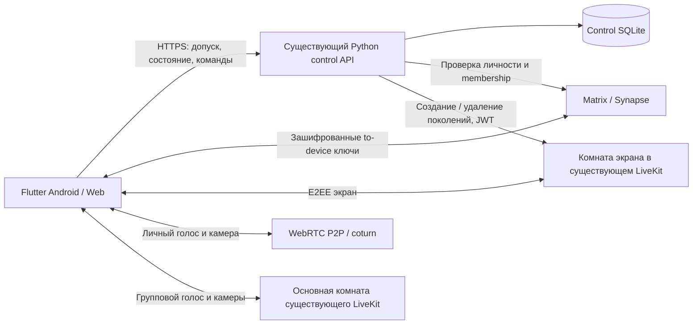

# Демонстрация экрана VoiceChat — техническое задание

Дата: 23 октября 2026. Версия: 1.0.

**Статус: реализация добавлена, локальные web/HTTP/SFU сценарии проверены;
полная межплатформенная приёмка не завершена. На VPS включён web preview
по запросу владельца для тестирования.** [Журнал](iterations/08-screen-sharing.md).
Источник — обсуждение владельца в чате «Оценить screen share для приложений»,
перенесённом из Marketplace в VoiceChat. Выводы о Java, React Native, Expo,
отсутствии медиатранспорта и сроках разработки Marketplace к этому проекту не относятся.

Единый исполняемый список: [задачи SS-00–SS-17](tasks/08-screen-sharing.md).
Фактическую готовность отражает [статус реализации](implementation-status.md).
При расхождении с ранним запретом screen share в архитектуре звонков этот документ
задаёт новый объём. Существующие требования E2EE и отзыва доступа сохраняются.

## 1. Цель и согласованный объём

Добавить демонстрацию экрана в существующие личные и групповые голосовые/видеозвонки.
В одном звонке показывает экран только один пользователь с одного выбранного устройства.
Любой допущенный участник может начать свой показ и автоматически заменить ведущего.
Согласие предыдущего ведущего и очередь заявок не требуются.

Подтверждено владельцем:

- Android-приложение и адаптивное веб-приложение; разработка нативного iOS исключена.
- Личные звонки и группы до 10 участников, включая ведущего.
- Экран — отдельная крупная область. Голос и включённые камеры продолжают работать.
- Звук устройства/вкладки/приложения не передаётся; микрофоны работают как прежде.
- Записи демонстрации нет.
- Весь серверный состав размещается на одной машине через Docker Compose.
- Реализация выполняется небольшими проверяемыми итерациями по чек-листу.

Не входят: новые виды чатов, публичные трансляции, гостевые ссылки, передача управления
мышью/клавиатурой, аннотации поверх экрана, запись, ретрансляция на внешние площадки,
автоматическая модерация изображения, новый протокол звонков, переписывание backend
на Go, перенос личного аудио/видео целиком на SFU, масштабирование на несколько серверов.
Новые SMS/SMTP/FCM-интеграции для этой функции не требуются.

## 2. Проверенная исходная структура

Это сведения из чтения кода, а не новый результат сквозных испытаний.

| Область | Текущая реализация | Что расширяем |
| --- | --- | --- |
| Общий клиент | Flutter/Dart, `apps/client` | Общие состояние и UI демонстрации, платформенный захват |
| Личные звонки | `DirectCall`, Matrix VoIP, `flutter_webrtc` | Привязка демонстрации к принятому личному звонку; аудио/камера сохраняют P2P/TURN |
| Группы | `CallProbe`, LiveKit E2EE, per-sender keys | Использование существующего допуска, доверия и криптографических проверок |
| Управление | Python `prototype/token_server.py`, `call_control.py`, SQLite | Допуск экрана, единственный ведущий, ревизия, восстановление, токены |
| Отзыв SFU | Непредсказуемые поколения комнат, удаление старой комнаты, `auto_create: false`, supervisor | Те же гарантии отдельно для канала экрана |
| UI | `call_controller.dart`, `call_window.dart`, `call_video_grid.dart`, `voice_call.dart` | Кнопки и отдельная область экрана, адаптивная раскладка |
| Android | `MainActivity.kt`, `CallService.kt`, foreground service микрофона | MediaProjection, foreground service захвата и остановка ресурсов |
| Развёртывание | `infra/compose.yaml`, `control.Dockerfile`, `supervise.py`, `configure.py`, Caddy | Расширение существующего образа и проверок, без второго SFU |

В lockfile на момент анализа: `livekit_client 2.13.1`,
`flutter_webrtc 1.6.2+hotfix.4`. Версии не обновлять без воспроизводимой необходимости.
Matrix SDK уже содержит `setScreensharingEnabled`, но само наличие метода не решает
серверный перехват, отзыв токенов и единое поведение двух транспортов.

Сейчас `allowsCallMedia` допускает только микрофон/камеру; обычный SFU JWT не допускает
screen share. `CallProbe.camera(false)` удаляет видеопубликации своей комнаты, а сетка
выбирает первую видеопубликацию. Эти ограничения нельзя обходить простым добавлением
кнопки и расширением JWT для всех участников.

Производственный VPS, физические Android, браузеры кроме прежних проверенных Chrome
и часть сетевых/фоновых сценариев ещё не приняты в проекте. Дизайн клиента сейчас
меняется в другой работе; применять новые UI-изменения поверх актуальной версии,
не откатывать и не коммитить чужие незавершённые изменения.

## 3. Функциональные требования

| ID | Требование |
| --- | --- |
| SS-F01 | Показ доступен внутри принятого активного личного или группового звонка. Из списка чатов отдельную трансляцию не создавать. |
| SS-F02 | Один авторитетный ведущий на звонок; остальные могут смотреть и продолжать разговор. |
| SS-F03 | Новый ведущий получает системное разрешение и готовит локальный захват до прекращения старого показа. Отмена выбора не меняет текущую демонстрацию. |
| SS-F04 | Успешный перехват прекращает передачу прежнего экрана всем зрителям; предыдущий ведущий остаётся в звонке зрителем. |
| SS-F05 | При конкуренции сервер сериализует команды. Устаревшая команда не перехватывает экран после более нового состояния. |
| SS-F06 | Ведущий может остановить свой показ, ОС также может завершить захват. Звонок и камеры продолжаются. |
| SS-F07 | Выход ведущего, завершение звонка, отзыв устройства/допуска прекращают его показ; прежний ведущий автоматически не восстанавливается. |
| SS-F08 | Новый участник текущего звонка получает актуальный экран после допуска и обмена ключами. Участник чата вне звонка доступа к экрану не получает. |
| SS-F09 | Камеры, mute и аудиомаршрут независимы от демонстрации; аудиодорожки захвата экрана не публикуются. |
| SS-F10 | Доступны полноэкранный просмотр, сохранение пропорций, поворот телефона, имя ведущего и явная кнопка остановки своего показа. |
| SS-F11 | При отсутствии платформенной поддержки отправки остаётся просмотр при поддержке E2EE; интерфейс объясняет ограничение и предлагает Android-приложение. |
| SS-F12 | Потеря сети, смена поколения, отказ API и перезапуск не оставляют второго ведущего, старую картинку под новым именем или скрытый локальный захват. |
| SS-F13 | Все кадры защищены E2EE до SFU; ключи известны только допущенным клиентам. Незашифрованного fallback нет. |
| SS-F14 | Собственная трансляция всегда имеет видимый индикатор. Нет скрытого автозапуска после reload, нового входа, восстановления backup или перезапуска процесса. |
| SS-F15 | Существующие звонки без демонстрации и старые совместимые клиенты продолжают работать; неподдерживаемая демонстрация не ломает базовый звонок. |
| SS-F16 | Развёртывание, миграция, отключение функции и восстановление выполняются в существующем Compose без удаления пользовательских томов. |

## 4. Платформы и границы поддержки

| Клиент | Отправка | Просмотр | Обязательная проверка |
| --- | --- | --- | --- |
| Android APK | MediaProjection через существующий SDK | LiveKit E2EE | Физический телефон, разрешение, фон, поворот, остановка ОС |
| Desktop Chrome/Edge | `getDisplayMedia`, HTTPS, пользовательское действие | LiveKit E2EE | Окно/вкладка/экран, отмена, системный Stop, реальная расшифровка |
| Desktop Firefox/Safari | По сочетанию поддержки захвата и E2EE SDK | Только при работающем E2EE | Зафиксировать проверенные версии; отсутствие API/codec/cryptor не скрывать |
| Мобильный веб Android | В текущих основных браузерах захват отсутствует | При поддержке E2EE SDK | Узкая раскладка, реальная декодировка, отсутствие неработающей кнопки |
| Safari iPhone/iPad | В закреплённом LiveKit Flutter 2.13.1 отправка из mobile web заблокирована SDK, несмотря на сведения MDN о новом API браузера | В рамках браузерной совместимости | Отдельная строка результата; нативный iOS не создавать |

Матрица отражает технические возможности, а не обещание поддержки любого браузера.
В SS-01 фиксируются конкретные версии ОС, браузеров, SDK и фактический результат
`capture / encrypt / decrypt / background`. Одного наличия `getDisplayMedia` недостаточно.
PWA не получает дополнительных прав захвата экрана. Для неподдерживаемого браузера
должен быть безопасный понятный отказ без переключения на открытое видео.

Источники платформенных ограничений: [MDN getDisplayMedia](https://developer.mozilla.org/en-US/docs/Web/API/MediaDevices/getDisplayMedia),
[данные совместимости](https://github.com/mdn/browser-compat-data/blob/main/api/MediaDevices.json),
[Android MediaProjection](https://developer.android.com/media/grow/media-projection).
Дата проверки источников — 23 октября 2026; перед реализацией SS-01 обновить сведения.

## 5. Архитектурное решение

### 5.1. Один сервер, два логических канала звонка

Использовать существующий LiveKit для **отдельной логической комнаты демонстрации**,
создаваемой по необходимости. Это дополнительное WebRTC-соединение клиента,
а не новый процесс SFU, отдельный VPS, новый broker или хранилище видео.

Причины выбора:

1. Старый JWT self-hosted LiveKit сам по себе не отзывается сменой permission или
   `RemoveParticipant`. Смена поколения и удаление комнаты уже решают это в проекте.
2. Для перехвата экрана нужно менять право публикации немедленно. Ротация общей
   комнаты переподключала бы также голос и камеры всех участников.
3. Отдельная комната позволяет ротировать только экран. Личный голос/камера сохраняют
   существующий прямой путь. В основной SFU-комнате screen source остаётся запрещён.
4. Одинаковая реализация экрана обслуживает личные и групповые звонки.

Цена решения — дополнительное соединение и ресурсы устройства. SS-01 обязан измерить
совместную работу P2P/SFU, камеры и захвата на Android. Если проверка не проходит,
зафиксировать причину и пересмотреть транспорт до основной реализации; не отключать
E2EE и не переносить весь личный вызов на SFU скрытно.

### 5.2. Владение данными и кодом

- Matrix остаётся источником аккаунтов, joined membership и устройств. Не читать БД Synapse напрямую.
- Control SQLite хранит только метаданные: привязку вызова, допуски устройств,
  выбранного ведущего, ревизию, поколения, квитанции команд и незавершённое удаление комнат.
- Кадры, медиаключи, токены Matrix и содержимое экрана не сохраняются сервером.
- LiveKit только пересылает E2EE-медиа; запись/egress не включаются.
- Общий контроллер демонстрации принадлежит активному `VoiceCall`, а не виджету окна.
  Закрытие/повторное открытие окна не теряет состояние и не запускает новый захват.
- UI получает типизированное состояние; не вызывает HTTP и платформенный захват напрямую.
- Переиспользовать `authorizedDevices`, проверку encrypted to-device sender,
  существующую криптографию SDK и ограничение отзыва. Общий код извлекать только для
  действительно одинаковых операций; не создавать универсальную платформу медиасценариев.

### 5.3. Допуск к базовому звонку

Группа: экран использует текущий `lease_id`, выбранные device keys и живой roster
`CallStore`. Повторно проверять Matrix identity/membership и срок lease на выдаче
токенов и изменениях; клиент не передаёт доверенный roster от своего имени.

Личный вызов сейчас не имеет такого серверного lease. Добавить минимальную привязку
его принятой сессии к двум выбранным устройствам в существующий control API:

1. После Matrix accept клиент знает `callId`, обе стороны и выбранное устройство
   собеседника из аутентифицированного сигналинга. Нельзя выводить выбор из списка
   всех устройств пользователя или только `isDirectChat`.
2. Каждая сторона отдельно подтверждает control API одинаковый состав пары и сессию,
   используя свой Matrix Bearer token. Control проверяет joined membership, ключи,
   совпадение взаимных подтверждений и отсутствие конфликтующего выбранного устройства.
3. До совпадения двух подтверждений экран недоступен; сам личный звонок может работать.
   Клиенты также сверяют привязку с текущим Matrix-звонком локально.
4. Привязка получает lease и обновляется пока активен именно этот вызов. `close`, отзыв
   и истечение lease закрывают доступ к экрану. Повторный звонок имеет другую сессию.

Это не попытка доказать серверу наличие P2P-пакетов: сервер авторизует взаимно
подтверждённое участие, а клиент проверяет действительность звонка. Точный mapping
Matrix `callId/party/device` закрепить контрактным тестом SS-03. Не расширять задачу
до переписывания всего личного звонка или исправления всей глобальной арбитрации.

## 6. Состояния и инварианты

### Серверная модель

`call_binding` — существующий групповой вызов либо подтверждённая личная сессия.
Один `screen_session` на binding, независимо от числа клиентов и окон.

| Поле | Назначение |
| --- | --- |
| `screen_session_id` | Непрозрачный ID текущей экранной сессии |
| `revision` | Монотонная ревизия команд и смены доступа |
| `state` | `idle`, `switching`, `active`, `unavailable`, `ended` |
| `owner_identity`, `owner_lease_id` | Выбранный пользователь/устройство и допуск; null без владельца |
| `screen_generation` | Непредсказуемое имя SFU-комнаты; не Matrix room ID |
| `roster_version` | Версия допущенного состава устройств |
| `operation_id`, `deadline` | Незавершённый переход, проверяемый при восстановлении |

`active` на сервере означает готовое поколение и действующее назначение владельца,
а не доказательство просмотра кадра каждым клиентом. Фактический статус публикации/
расшифровки ведётся отдельно. Если owner не опубликовал трек в пределах transition
deadline, контроллер отзывает назначение и удаляет поколение; heartbeat с одним
лишь `capture_ready` не продлевает бесконечно пустой показ.

Сопутствующие записи: квитанция `(binding, actor device, request_id, fingerprint,
result_revision, result_status)`; список retired rooms для надёжного удаления.
Секретные bearer/lease значения не возвращать зрителям в общем snapshot.
Привязка к конкретным таблицам и миграция — SS-02; новые поля не записываются в Matrix history.

Инварианты:

- В текущем поколении право `screen_share` есть ровно у одного identity либо ни у кого.
- Перед выдачей права новому ведущему предыдущая комната уничтожена с подтверждённым
  результатом. `auto_create: false` проверяется на реально запущенном SFU.
- Неизвестный результат удаления означает `switching/unavailable`, а не разрешение нового показа.
- Ревизия проверяется и меняется атомарно. Сетевые операции не выполняются внутри SQL-транзакции.
- Старый worker не создаёт/активирует новое поколение после более новой команды:
  одна сериализованная обработка на binding, сверка `operation_id/revision` до и после IO,
  compensating cleanup случайно созданной устаревшей комнаты.
- Не выдавать JWT до подтверждённой очистки старого поколения и готовности нового.
- Viewer JWT: subscribe, без publish/data/admin. Publisher JWT: только `screen_share`,
  без microphone/camera/screen audio/data/admin. Не расширять обычный `/token` всем участникам.
- Разрешение source проверяется SFU; клиент дополнительно принимает только владельца,
  поколение, разрешённый source и E2EE. SFU не умеет доказать, что модифицированный
  клиент назвал «экраном» именно системный захват; это не обещаем.
- Дублированные видеотреки одного владельца не создают несколько областей экрана:
  протокол выбирает одну подтверждённую публикацию текущего поколения; нарушение
  закрывает экранный допуск нарушителя. Не полагаться на порядок `firstOrNull`.
- Подписанные SFU-события либо ограниченная серверная сверка publications обнаруживают
  отсутствие/лишние публикации. Клиентское сообщение о нарушении само по себе не
  отзываёт чужой доступ. До сверки receiver показывает только выбранный допустимый track.
- Терминальный binding не оживает от heartbeat, старого request_id или токена.

### Клиентная модель

`unsupported → idle`; рабочие переходы:
`idle/viewing → selecting → preparing → switching → sharing`.
Дополнительно: `reconnecting`, `stopping`, `error`, `closed`.

`selecting/preparing` — локальные состояния, сервер ещё не сменил ведущего.
`sharing` показывается только после публикации своего актуального трека;
`viewing` — после подключения и фактической расшифровки принимаемого экрана.
Во время ожидания показывать соответствующее сообщение, а не «идёт трансляция».

## 7. Пользовательские сценарии

### Начало и перехват

1. Клиент проверяет активный звонок, допуск, поддержку захвата и отсутствие своего
   незавершённого запуска. Кнопка: «Показать экран» либо «Показать мой экран вместо текущего».
2. Из непосредственного пользовательского действия запускается системный picker.
   На вебе не ставить перед `getDisplayMedia` сетевые ожидания, теряющие user activation.
3. Захват создаётся локально без публикации; проверить живой video track, удалить
   непрошенные аудиотреки, убедиться, что звонок не завершён за время разрешения.
4. Отправить `claim` с последней увиденной `revision` и новым `request_id`.
   Если snapshot устарел, вернуть конфликт, остановить подготовленный захват и
   показать актуального ведущего. Не запускать бесконечный автоматический перехват.
5. Control атомарно резервирует переход, запрещает новую выдачу старых токенов,
   удаляет старую экранную комнату, создаёт новую и фиксирует владельца/поколение.
6. Клиенты получают новый snapshot. Новый ведущий передаёт новый E2EE-ключ через
   Matrix только допущенным устройствам, подключается и публикует экран.
7. Предыдущий ведущий останавливает capture, освобождает native resources и остаётся
   зрителем. Получатели удаляют старый renderer/буфер до отображения нового ведущего.

При одновременном `claim` с одной ревизией выигрывает первый валидный commit;
второй получает 409. Последующее осознанное нажатие с новой ревизией перехватывает
показ. Это даёт однозначный порядок без цикла взаимных автоматических перехватов.

Отмена picker или локальная ошибка подготовки не выключает предыдущий экран.
После серверного отзыва старого поколения новая публикация может не состояться:
показать ошибку/`idle`, освободить захват, не возвращать старый экран автоматически.
Нулевой разрыв между экранами не обещается; аудио и камеры не переподключать ради перехвата.

### Остановка и уход

- «Остановить показ» сначала прекращает локальный захват, затем идемпотентно отзывает
  поколение. При сетевом сбое heartbeat/reconcile доводит серверное состояние до конца.
- Системный Stop/onEnded/onStop проходит тот же cleanup. Не останавливать микрофон звонка.
- Запоздалый `stop` прежнего владельца не останавливает нового: проверять owner/revision.
- Завершение/отзыв звонка закрывает экран, renderer, события, таймеры и foreground capture.
- Выход зрителя исключает устройство из будущих ключей и вызывает смену экранного
  поколения. Ведущий может продолжить живой локальный capture в новом поколении,
  только если он всё ещё владелец и ОС не отозвала разрешение.
- Новый участник получает новый защищённый контекст. Будущую передачу закрывают от
  исключённых устройств; уже полученные ими кадры и ключи стереть удалённо нельзя.

### Обрывы и возобновление

- Короткий обрыв: обновить snapshot и допуск прежде, чем повторно публиковать.
- Возобновление того же живого capture допустимо только прежнему актуальному owner
  в той же открытой пользовательской сессии. Потерявший владение остаётся зрителем.
- Истечение lease, длительная потеря авторизации или ошибка криптографии прекращают
  показ с закрытием ресурсов. Новый запуск — явное действие пользователя.
- После падения control/SFU supervisor сохраняет существующее fail-closed поведение.
  Восстановление чистит retired rooms и leases; новые комнаты и ключи не наследуют
  разрешения завершённых сеансов. Backup не восстанавливает активную трансляцию.
- Уведомление не может остановить capture у злонамеренного клиента; гарантия сервера —
  прекращение доставки старого потока и доступа к новому, даже если клиент игнорирует Stop.

## 8. Контракт управления экраном

Это целевой контракт добавляемой функции, **не описание уже существующих endpoints**.
Внешний префикс `/api`, как в Caddy; обработчики существующего Python API видят путь
без этого префикса. Matrix Bearer token — в заголовке, не URL. Body строго проверяется:
известные поля, типы, длины, размер; device/identity авторизуются по токену.

| Метод / путь | Запрос / результат |
| --- | --- |
| `POST /api/screen/bind` | `protocol_version:1`, `room_id`, `call_session`, `transport:direct|group`; group — собственный call lease, direct — выбранная взаимно подтверждаемая пара. Возвращает binding, capabilities, состояние допуска. |
| `POST /api/screen/unbind` | Свой binding/lease, `request_id`; снять экранное участие, при необходимости завершить показ. |
| `GET /api/screen/{binding}/state` | Авторизованный snapshot: revision/state, owner public identity, generation, roster_version, capabilities, deadline/server_time. Нет чужих секретов/токенов. |
| `POST /api/screen/{binding}/claim` | Свой lease, `request_id`, `expected_revision`; результат операции и snapshot, без ключа изображения. |
| `POST /api/screen/{binding}/stop` | Свой lease, `request_id`, `expected_revision`; остановка только своего текущего владения. |
| `POST /api/screen/{binding}/heartbeat` | Свой lease, наблюдаемая revision, состояние своего capture/publication; проверяет доступ, возвращает snapshot. Не передаёт владение. |
| `POST /api/screen/{binding}/token` | Свой lease, точная revision/generation; ограниченный JWT на одну комнату/identity/роль. При устаревшем состоянии токен не выдаётся. |
| `GET /api/screen/{binding}/operations/{request_id}` | Собственный результат принятой команды после неизвестного HTTP-исхода; не позволяет читать чужую квитанцию. |

Для direct bind дополнительно: пара user/device, идентификатор Matrix-звонка и
подтверждение собственного выбранного устройства. Формат и лимиты получают fixtures
в SS-03 после проверки фактического Matrix SDK. Значения peer не дают полномочий;
требуются независимое подтверждение второй стороны и серверные проверки.

Для group bind вторичный экранный допуск ссылается на основной lease, не забирает
второе место в лимите 10 и не создаёт вторую активную пользовательскую сессию.
Для direct вести выбранный pair lease без подмены существующей SFU audio admission.

Snapshot не содержит список всех устройств комнаты: только допущенные устройства
этого звонка и необходимые проверенные public keys/identity. Клиент дополнительно
сверяет их с Matrix trust store и текущим `VoiceCall`.

`protocol_version` — integer 1; неизвестная версия не понижает защиту молча.
`request_id` — UUID; `expected_revision` — неотрицательное целое; `transport` —
строгий enum. Для `room_id` сохранить текущий предел 255 символов. Формат
`call_session` валидировать по реальным Matrix/групповым идентификаторам, не применять
групповое регулярное выражение к личному `callId`. Непрозрачные bindings/leases
ограничить серверным форматом. Входное JSON-тело не более 8 КиБ, roster не более
10 записей, ответ с токеном/snapshot не более 32 КиБ. Отсутствующий owner/generation
в `idle/ended` представляется явным null; массив допущенных участников может быть пуст.
Время протокола — Unix milliseconds UTC; клиент не задаёт серверные deadlines.

### Идемпотентность, порядок и ошибки

- `request_id` — UUID, создаётся на пользовательскую команду. Повтор того же тела
  возвращает ту же квитанцию и **не** выполняет новый перехват/ротацию.
- Другой fingerprint с тем же request_id: 409 `idempotency_conflict`.
- Проверка текущего доступа выполняется и перед повтором; квитанция не является
  бессрочным пропуском. Старый успешный claim возвращает прежний результат отдельно
  от текущего snapshot; нельзя выдать новый JWT на основании старой квитанции.
- Начатая операция: 202 и operation reference; завершённая: 200. При таймауте клиент
  проверяет свою квитанцию/состояние и повторяет тот же запрос, не генерирует новый ID.
- 400 `invalid_request`; 401 `unauthorized`; 403 `screen_access_denied`;
  404 `screen_session_not_found` без раскрытия чужой сессии;
  409 `screen_revision_conflict`, `screen_transition_in_progress`, `screen_not_owner`,
  `screen_binding_mismatch`; 410 `call_ended`/`lease_expired`;
  429 `screen_rate_limited`; 503 `screen_unavailable`.
- Локальные причины отдельно: `capture_unsupported`, `capture_cancelled`,
  `capture_denied`, `capture_ended`, `encryption_unsupported`, `publication_failed`.
  Отмена пользователем не показывается как серверная авария.
- Не возвращать необработанные исключения ОС/SDK, URL с токенами или приватные keys.

### Доставка состояния

Первая реализация — ограниченный опрос snapshot существующим HTTP control API:
во время открытого звонка примерно раз в секунду, немедленно после собственной команды,
без параллельных запросов одного клиента. Heartbeat может возвращать тот же snapshot;
в этом цикле отдельный GET не нужен. После сетевого восстановления всегда читать snapshot.
`revision` защищает от переставленных ответов. SSE/WebSocket для control специально
не вводить: их добавление не нужно для корректности небольшого семейного сервера.

На новом поколении отключение старой SFU-комнаты прекращает старый поток независимо
от опроса UI. Webhook/событие SDK — повод перечитать состояние, не авторитетный owner.

## 9. Шифрование и безопасность

Существующий принцип LiveKit E2EE расширяется на отдельный экранный video track.
Не использовать `server-known shared key`, запись экрана в Matrix media store или
видео по обычному HTTP. TLS/DTLS транспорта не заменяет E2EE относительно SFU.

Для каждой новой screen generation ведущий генерирует свежий ключ SDK. Отправка
только через encrypted Matrix to-device выбранным доверенным устройствам roster.
Отдельный тип envelope, например `dev.voicechat.screen_key.v1`, с полями:
`protocol_version`, `room_id`, `call_session`, `binding_id`, `screen_generation`,
`revision`, `roster_version`, `sender_identity`, `sender_device`, `expires_at`, `key`.
Нельзя применять ключ экрана к аудио/камере или переиспользовать его между поколениями.

Получатель проверяет криптографического отправителя, его device keys/trust, актуального
owner, точные binding/generation/roster, срок и размер ключа. Переиспользовать проверки
из `CallProbe`, а не доверять присланному `sender_identity`. Не писать ключи/токены
в логи, diagnostics, crash reports, SQLite, Matrix timeline и key backup.

Renderer сначала может быть смонтирован для получения кадров adaptive stream, но
до подтверждённой расшифровки закрыт безопасной заглушкой. `encryptionType=kGcm`
и включённый флаг E2EE сами по себе не являются доказательством расшифровки.
Допуск к кадрам проверяется по owner/generation/source и текущему разрешённому codec.
Ограничение AV1 в текущем проекте не снимать без отдельной E2EE-проверки.

При перехвате, остановке, исключении и отзыве удалять старую экранную комнату;
проверять реальный отказ сохранённому publisher/viewer JWT, включая обновлённый SDK
токен и попытку заново создать удалённую room. TTL — дополнительная мера, не отзыв.
Источник ограничения self-hosted: [LiveKit tokens and grants](https://docs.livekit.io/frontends/reference/tokens-grants/).

Захват может включать уведомления и приложения пользователя: перед первым показом
объяснить это коротким текстом и оставить выбор системному picker. Не обещать
автоматическое скрытие чужих приложений или защиту от записи участником звонка.
Защищённые ОС поверхности могут быть чёрными; обход таких ограничений не реализовывать.

## 10. Платформенный захват и UI

### Android

- Использовать поддерживаемый путь screen capture уже подключённого LiveKit/
  flutter_webrtc. До добавления Kotlin-кода проверить, что реально предоставляет SDK.
- Настроить MediaProjection foreground service и требуемые permissions/type для
  целевого Android. Текущий `CallService` имеет только `microphone`; этого недостаточно.
  Проверять merged manifest, не только исходный XML; не запускать два конкурирующих
  владельца MediaProjection в SDK и собственном сервисе.
- Системное разрешение получать на каждый новый захват; не сохранять/переиспользовать
  истёкший projection token. Сервис запускать в разрешённом ОС порядке после согласия.
- Android 14+: выбор отдельного приложения/всего экрана оставить системному picker.
- Поддержать `onStop`, уничтожение Activity, поворот, смену размеров и выход из приложения.
  Захват должен продолжаться при переходе в другое приложение, пока это разрешает ОС.
- Текущая политика остановки камеры в фоне сохраняется: требование «камеры продолжаются»
  не обходит ограничения ОС и не включает камеру, которую пользователь выключил.
- Постоянное уведомление с остановкой показа; остановка не завершает голосовой звонок.
  Lock/force-stop/системный отзыв корректно освобождают Surface, треки и projection.
- Если используется общий call service, прекращение screen capture не прекращает
  microphone foreground service, и наоборот. Проверить конфликт с голосовыми записями/
  видеокружком и `active_capture.dart`, без глобального выключения звонка.

### Веб

- HTTPS/secure context, собственный user gesture, реальный picker, корректная отмена.
- Отсутствие API, запрет Permissions Policy, отказ пользователя и ошибка E2EE различимы.
- Запрос захвата `audio:false`; при неожиданном audio track немедленно остановить его.
- `track.onEnded`, browser Stop, закрытие вкладки и logout очищают состояние; beacon
  не заменяет server lease. При reload показ не начинается автоматически.
- Не отправлять название окна/вкладки/URL на сервер. Не сохранять последний кадр.
- Нельзя полагаться на точные web constraints для выбора конкретного окна: выбор у пользователя.

### Общий интерфейс

- Одна основная кнопка: старт / перехват / остановка; недоступные действия имеют пояснение.
- Имя ведущего, индикатор своего показа, краткое сообщение «Теперь экран показывает …».
- Основная область — экран с `contain`, без обрезки и зеркального отображения.
  Камеры остаются отдельной полосой/сеткой; не смешивать screen track с camera tile.
- На узком экране основные действия остаются доступны; отдельный полноэкранный просмотр
  можно закрыть без завершения звонка. Учитывать safe areas, landscape и клавиатуру.
- При подготовке/обрыве показывать статус без старого кадра под новым владельцем.
- При неизвестном исходе команды кнопки не запускают второй параллельный запрос.
- Семантические подписи, focus/keyboard navigation, screen reader, достаточные touch
  targets, контраст и reduced motion; все действующие темы сохраняются.
- Камера и микрофон не включаются автоматически при старте/остановке экрана.

## 11. Параметры, качество и ресурсы

Ниже стартовые технические значения для проверки, а не новые продуктовые SLA.
При SS-01/SS-14 корректировать по измерениям, записывая причины в отчёте.

| Параметр | Стартовое значение / правило |
| --- | --- |
| Участники | Существующий лимит 10; экран не занимает дополнительное пользовательское место |
| Capture preparation | До 15 с после получения разрешения; время раздумья в picker не считается |
| Transition deadline | 15 с; при недоказанном отзыве новый publisher не допускается |
| Snapshot poll / heartbeat | Около 1 с / 3 с, не более одного незавершённого запроса каждого вида |
| Lease / stale authorization | Переиспользовать 30 с / клиентское закрытие не позднее 25 с без успешной авторизации |
| Screen JWT | Начальный TTL 60 с, строго одна generation/роль; срок не заменяет удаление room |
| Команды | Один незавершённый переход на binding; начально не более 5 claim за 10 с на устройство, 429 с retry_after |
| Квитанции | Сохранять до завершения binding; закрытые технические квитанции — 24 ч, без содержимого экрана; поздний повтор завершённой сессии всегда 410 |
| Auto | Начальный предел 1920×1080, 15 fps, 2.5 Мбит/с, с адаптацией к сети и устройству |
| Low | До 1280×720, 5–10 fps, 1 Мбит/с; пропорции сохраняются, без обязательного upscale |

Не вводить отдельную страницу десятков настроек: использовать существующий подход
Auto/Low и серверный конфиг только для значений, которые реально нужны в эксплуатации.
Параметры задают верхние ориентиры, а не гарантированный bitrate каждой сцены.
Читаемость текста проверяется наряду с fps; демонстрация динамичного видео не является
отдельным оптимизируемым режимом первой версии.

Безопасность приёмки обязательна независимо от задержки. Ориентиры на контролируемой
сети: первый расшифрованный кадр до 5 с после разрешения, перехват до 5 с после claim,
остановка локального capture до 1 с. Измерить p50/p95 и максимумы отдельно; превышение
разобрать до релиза, не скрывать усреднением. Для мобильной сети указать RTT/loss/bandwidth.

При одном ведущем и девяти удалённых зрителях поток 2 Мбит/с даёт около 18 Мбит/с
исходящего screen-трафика SFU плюс протокол, аудио/камеры и возможный TURN. Это расчёт,
не измеренная вместимость VPS. Дополнительный декодер и одновременный encoder камеры
на телефоне требуют проверки нагрева/памяти/батареи. Предел одновременных звонков
определить измерениями конкретной машины, не объявлять неограниченным.

## 12. Развёртывание на одной машине

Переиспользовать `infra/compose.yaml`: web/Caddy, Synapse/PostgreSQL, coturn,
контейнер control с текущим LiveKit под supervisor и постоянным control volume.
Не создавать второй LiveKit, второй coturn, отдельную screen БД или Redis.
Экранные room names отделены от основных звонков; существующий `auto_create:false`
и удаление retired generations остаются обязательными.

Текущий сетевой план: TCP 80/443; SFU TCP 7981 и UDP 50300–50400;
TURN TCP/UDP 3488 и UDP 49300–49400. Новых портов только из-за screen share нет.
Эти значения брать из актуальных конфигов при реализации, не переписывать вручную
в нескольких местах. Новые control paths должны проходить Caddy, а внутренние
административные endpoints, секреты и диагностика не должны открываться наружу.

Нужны публичный адрес либо настроенный NAT, домен и TLS, доступные UDP/TCP-порты,
свободный трафик/ресурсы. TURN/TLS на 443 сейчас не настроен: его проверка — отдельная
строка сетевой приёмки. При необходимости поддержки сети, разрешающей только 443,
проектировать совместное размещение с HTTPS через проверенную L4/SNI-схему; второй
HTTP location не превращает TURN в HTTPS. До такой проверки не обещать работу через
любую корпоративную сеть. Покупка облачного сервиса не требуется для этого ТЗ.

Миграция SQLite additive/versioned, идемпотентна; backup перед обновлением. Отдельная
проверка fresh DB, прежней populated DB, повторного запуска и прерывания миграции.
Не очищать контакты, сообщения, scheduled jobs или Synapse media. Обновить COPY новых
Python-модулей в Dockerfile, backup coverage и deployment tests.

Feature flag/capability сначала выключены. Включать после серверных и клиентских
проверок; отключение запрещает новые claim/token и отзывает активные screen rooms,
сохраняя базовый звонок, если инфраструктура исправна. Откат допускается только на
совместимую схему; старый образ не должен обслуживать оставшиеся screen grants.
Активные сеансы перед откатом закрываются. Restore не возобновляет screen leases.

Метрики без содержимого: число активных экранов, длительность перехода/запуска,
отказы допуска/публикации/E2EE, pending cleanup, возраст authorization, traffic/loss,
CPU/RAM control/SFU. Логи — request_id и безопасный код; не полный JWT, SDP, ключ,
название окна или screenshot. Не добавлять новую систему мониторинга ради нескольких
счётчиков; использовать текущие журналы и healthchecks.

## 13. Приёмка и проверочные свидетельства

| ID | Сценарий и ожидаемый результат |
| --- | --- |
| SS-A01 | Web A показывает реальное окно → web B декодирует и видит контрольный рисунок/текст; голос и камера работают. |
| SS-A02 | Физический Android показывает другое приложение → web видит правильный экран; повторить web → Android. |
| SS-A03 | В аудиозвонке можно показать экран без включения камеры; mute до/во время/после сохраняется. |
| SS-A04 | Группа: один ведущий, девять зрителей; позднее подключение, выход и возврат, экран отдельно от камер. |
| SS-A05 | A → B → C: каждый перехват меняет единственного ведущего, прежние остаются зрителями, голос не переподключается. |
| SS-A06 | Два claim одной ревизии: одна успешная команда; другой клиент получает конфликт и прекращает подготовленный захват. |
| SS-A07 | Повтор потерянного HTTP-ответа не ротирует комнату ещё раз; старый stop/claim/heartbeat не меняет нового ведущего. |
| SS-A08 | Отмена/отказ picker, закрытие звонка во время picker, сбой создания трека: прежний экран не меняется, новые ресурсы закрыты. |
| SS-A09 | Browser Stop, Android системный Stop, lock, exit, logout и отзыв устройства: ресурсы и доступ прекращаются в установленные сроки. |
| SS-A10 | Сохранённый старый JWT и независимый клиент после перехвата/stop/исключения не могут вернуться в старую комнату или публиковать в новой. |
| SS-A11 | Посторонний Matrix member вне звонка, чужое устройство, подмена binding/owner/source/request_id и обход UI получают отказ. |
| SS-A12 | Нет ключа/неверный ключ/старый envelope/неверный sender: кадры не раскрываются. Правильный ключ даёт фактически расшифрованные кадры. |
| SS-A13 | Нет screen audio: при выключенном микрофоне воспроизведение звука на устройстве не создаёт аудиопоток адресату. Существующий микрофон не теряется и не дублируется; акустический звук, попавший в включённый микрофон, не считается системной аудиодорожкой. |
| SS-A14 | Обрыв claim/delete/create/publish, перезапуск control/SFU, истечение lease и недоступный Matrix: нет двух ведущих, cleanup завершается. |
| SS-A15 | Wi-Fi ↔ мобильная сеть, relay-only и ограниченная сеть: измеренный результат, понятный отказ при недоступном транспорте. |
| SS-A16 | Все темы, узкие размеры/landscape, клавиатура/screen reader, fullscreen, отсутствие mirror/crop и устаревшего кадра. |
| SS-A17 | Старые клиенты, feature off, повторная миграция и backup/restore: базовые звонки/данные сохранены, старый экран не оживает. |
| SS-A18 | Длительный прогон и многократные start/stop/перехваты не накапливают треки, connections, rooms, timers и foreground services. |

Для каждого результата сохранять commit, версии ОС/браузера/SDK, схему сети,
физическое устройство либо эмулятор, длительность, наблюдения и PASS/FAIL/BLOCKED.
Синтетический track подходит для автоматической регрессии, но не заменяет picker/
MediaProjection и физическое устройство. «E2EE включено» не заменяет доказательство
расшифровки и отрицательный сценарий без ключа. Использовать только тестовое содержимое;
скриншоты реальной переписки/секретов не включать в артефакты.

## 14. Завершённость и порядок выполнения

Реализация считается завершённой после SS-00–SS-17, выполнения обязательной матрицы,
обновления инструкций запуска/ограничений и отсутствия незакрытых критических дефектов
в допуске, E2EE, перехвате и освобождении ресурсов. Реальные ограничения конкретного
браузера не устраняются притворным PASS: отражать поддержку явно в UI и документации.

Закрытые бизнес-решения перечислены в §1; дополнительных вопросов владельцу сейчас
нет. До финальной приёмки нужны внешние сведения: целевой VPS/канал/домен, физический
Android и доступные браузеры. Их отсутствие не блокирует контракт, локальные unit-тесты
и реализацию, но блокирует соответствующие реальные проверки и объявление релиза готовым.

Последовательность и все зависимости — [чек-лист](tasks/08-screen-sharing.md).
В этом документе нет разрешения немедленно разворачивать production или запускать
тяжёлые медиапрогоны: текущая задача — подготовить ТЗ. Сохранить действующее ограничение
на тяжёлые локальные тесты/параллельные сборки до отдельного указания владельца.

## 15. Источники и основание решения

- Код и соглашения: [звонки](architecture/calls.md), [решения](architecture-decisions.md),
  [эксплуатация](../infra/README.md), [безопасность](architecture/security.md).
- [LiveKit screen sharing](https://docs.livekit.io/transport/media/screenshare/) —
  платформенный захват и screen video track.
- [LiveKit E2EE](https://docs.livekit.io/transport/encryption/) — шифрование медиадорожек;
  прикладное распределение ключей остаётся обязанностью VoiceChat.
- [LiveKit tokens](https://docs.livekit.io/frontends/reference/tokens-grants/) —
  ограничения self-hosted отзыва токенов; короткий TTL не заменяет ротацию комнаты.
- [LiveKit deployment](https://docs.livekit.io/transport/self-hosting/deployment/) и
  [Docker Compose deployment](https://docs.livekit.io/transport/self-hosting/vm/) —
  сетевые требования; в проекте уже есть собственная однохостовая схема.

Архитектура отдельного экранного поколения, контракты и план выше — инженерное
решение для VoiceChat, не готовая гарантия, предоставляемая одним методом SDK.
