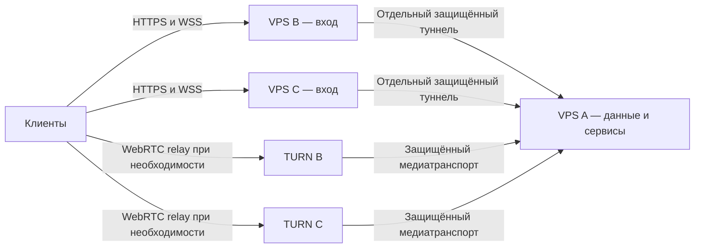

# Техническое задание на работу VoiceChat через три VPS

Дата: 28 октября 2026. Версия: 1.2. Статус: требования согласованы в обсуждении;
технические параметры ниже являются проектными значениями для проверки при реализации.
Локальная разработка начата 28 октября 2026: [журнал](iterations/19-three-vps.md).
Полная схема не реализована и не развёрнута. ТЗ не является командой на деплой.

Подробный [план реализации V3-00–V3-29 и будущего backup](tasks/19-three-vps.md)
с зависимостями, проверками и перечнем участия владельца сохранён отдельно.

## 1. Цель и согласованный объём

**Уточнение объёма от владельца, 30.10.2026:** текущий этап — работающий один VPS
с core A и edge-a, подготовленный к добавлению независимых входов конфигурацией.
Перенос доступного A (HA-19 / V3-22) отложен в [отдельную задачу](tasks/22-core-relocation.md)
и не блокирует этот этап. Проверки физического multi-host failover сохраняются
условными до появления дополнительного VPS; их не заменяет односерверная приёмка.

VoiceChat использует один основной сервер A с единственной рабочей копией данных
и два независимых входных сервера B и C. Клиент заранее знает оба входа, проверяет
их перед подключением, выбирает доступный устойчивый маршрут с меньшей задержкой
и автоматически восстанавливает соединение через другой вход при сбое.

Дополнение владельца от 28 октября: B/C — начальная конфигурация, а не жёсткое
ограничение числа входов. D/E и следующие узлы добавляются через конфигурацию и
подписанный каталог, без изменения кода и выпуска новых версий установленных
клиентов. Требования к edge применяются ко всем входам. Начальный технический
предел — 32 входа на установку; он ограничивает размер каталога и число проб.

Дополнение владельца: поддерживается начальная установка на **одном VPS** с core
и единственным edge. Формат допускает 1–32 входа. Это тот же клиентский контракт
с подписанным каталогом, а не отдельная одноразовая версия приложения. Роли имеют
раздельные Compose projects/runtime даже на одной машине. В inventory совмещение
задаётся явной ссылкой edge `host: core`, без копирования host credentials.

Позже добавляются независимые B/C/D, публикуется новая revision каталога, и edge
с A можно перенести или вывести из эксплуатации. Не меняются Matrix server_name,
canonical origin, аккаунты, данные и signing key. Авторизация остаётся на core;
edge лишь передаёт разрешённые запросы. Для переноса существующего edge hostname
требуются новый host assignment/поколение, bootstrap, проверенный SSH key, TLS,
туннель/firewall и контролируемая смена DNS. Изменение inventory само по себе
не выполняет эти операции. Клиентский код при добавлении входов не переписывается.

Пока физический VPS один, отказ этого хоста/IP останавливает все его роли:
локальная раздельность служб не является резервированием. Приёмка независимого
failover выполняется после появления минимум двух независимых входов. До их
появления можно завершить код и локальные проверки, но не объявлять внешнюю
отказоустойчивость и аппаратную матрицу проверенными.

В MVP входят переписка, API, файлы, личные и групповые звонки, видео и демонстрация
экрана в пределах уже поддерживаемых функций. Схема действует на всех поддерживаемых
клиентах и является обязательным контрактом для будущих клиентов, включая Windows.
Реализация Windows и новых медиавозможностей не входит в эту доработку.

Пользователь согласовал короткую паузу при восстановлении звонка, без повторного
принятия, пока серверный сеанс действителен. Цель — восстановление до 15 секунд
после обнаружения сбоя; безопасное завершение с понятной ошибкой при невозможности
восстановления. Для первоначального открытия веб-приложения допустим заранее
известный резервный адрес с повторным входом и восстановлением ключей.

Обязательная часть MVP — простая замена любого входного VPS: подготовка чистой
машины, установка, конфигурация, деплой, проверка и переключение адреса без правок
клиентского кода и выпуска новых приложений. Замена A дополнительно требует переноса
данных с доступного старого A; после его потери — восстановления из внешней копии.

Внешний зашифрованный backup и аварийное восстановление после полной потери A
заложены в целевое решение после MVP. Существующие локальные копии и согласованный
backup перед обновлением A сохраняются. Перенос внешнего backup за пределы MVP
не разрешает отключать уже существующие проверки и защиту обновления данных.

### 1.1 Что схема гарантирует и чего не гарантирует

| Событие | Требуемое поведение |
| --- | --- |
| IP A недоступен пользователю, хотя A доступен с B/C | Переписка и медиатрафик работают через доступный вход |
| B или C выключен, не оплачен либо заблокирован у пользователя | Клиент использует оставшийся исправный маршрут |
| B работает, но его соединение с A нарушено | B не считается готовым для затронутого сервиса; используется C |
| У разных пользователей заблокированы разные входы | Каждый выбирает свой маршрут; пользователи остаются в общих чатах и звонках |
| Основной веб-адрес не открывается | Пользователь может открыть резервный; автоматический API failover работает после загрузки приложения |
| A или его база недоступны с обоих входов | Понятный статус недоступности; B/C не принимают самостоятельные записи |
| A потерян вместе с диском до внедрения внешних копий | Восстановление серверных данных не гарантируется |
| Сеть блокирует оба входа, их домены или все доступные транспорты | Работа не гарантируется; нет обещания обхода любых фильтров |

Клиентские локальные данные и пользовательские ключи остаются на устройствах по
существующим правилам. «Одна рабочая копия» относится к серверным данным, а не к
клиентским кешам, поставочным артефактам и будущим зашифрованным резервным копиям.

## 2. Исходное состояние и зависимости

Основание — код рабочей копии 28 октября 2026, базовый HEAD `bca5b46`.
Перед реализацией повторно сверить актуальный код и production release.

- [Compose](../infra/compose.yaml) размещает PostgreSQL, Synapse, control/LiveKit,
  TURN и web на одном хосте. Постоянные данные есть не только у PostgreSQL:
  нужны Synapse media/signing/config и SQLite/состояние control.
- [Caddy](../infra/Caddyfile) обслуживает Matrix, API, WSS, web и обновления.
  Административные и внутренние маршруты закрыты на публичном входе.
- [Генератор клиента](../infra/client_config.py) выводит `MATRIX_URL`, `TOKEN_URL`
  и `LIVEKIT_URL` из одного origin; [MatrixProbe](../apps/client/lib/matrix_probe.dart)
  проверяет origin сохранённого профиля при повторном входе.
- [Конфигурация сервера](../infra/configure.py) задаёт один публичный IP для
  SFU/TURN. TURN/TLS на 443 отсутствует.
- [Supervisor](../infra/supervise.py) связывает жизненный цикл control и LiveKit:
  потеря работоспособности авторизатора должна прекращать медиадоступ.
- [Release workflow](../.github/workflows/deploy.yml), [deploy.py](../infra/deploy.py)
  и [source guard](../infra/release_source.py) сейчас поддерживают один хост,
  режимы `full` и `web`, immutable images, backup, healthchecks и rollback pointers.
  Описанные далее режимы ещё не реализованы.

Связанные контракты: [перевод звонка](call-handoff-spec.md),
[P2P Share](p2p-share-spec.md), [обновления Android](android-apk-update-spec.md),
[Windows](windows-spec.md), [порядок релизов](../infra/README.md).
Failover не должен сам инициировать перевод звонка на другое устройство,
воскрешать завершённую передачу P2P или добавлять автоматическую установку обновлений.

## 3. Роли серверов и границы хранения

| Ответственность | A — core | B и C — edge |
| --- | --- | --- |
| Аккаунты, события Matrix, членство, ключи подписи сервера | Единственный Synapse и PostgreSQL | Только передача разрешённых запросов |
| Зашифрованные вложения и постоянные данные control | Единственное рабочее хранилище | Потоковая передача без постоянного кеша |
| Авторизация, call/screen leases, расписание, push bindings | Единственный экземпляр соответствующих сервисов | Без собственной бизнес-логики и БД |
| LiveKit SFU | На A, вместе с текущим control/supervisor | WSS-прокси и TURN-путь до SFU |
| TURN для поддерживаемых WebRTC-сценариев | Выдача клиентам временных credentials через API | По одному TURN на B и C |
| Веб-приложение и публичные установщики | Источник релиза — CI/реестр | Одинаковые проверенные артефакты на обоих входах |
| TLS и служебная конфигурация | Для своей роли | Собственные сертификаты, ключи туннеля, конфигурация своей роли |
| Healthchecks и эксплуатационные метрики | Состояние core и зависимостей | Состояние входа, upstream и ретрансляции |

B и C не требуют связи друг с другом для обслуживания пользователей. Каждый
самостоятельно соединяется с A. На A не создаются отдельные БД или аккаунты для
разных входов. Общая файловая система между VPS и репликация БД не нужны.

Прямой WebRTC между пользователями остаётся допустимым. Выбор HTTP-входа B не
обязывает использовать TURN B, если ICE установил лучший допустимый медиапуть.
Нужна доступность через каждый вход, а не искусственное закрепление всех пакетов
за одним сервером. Смена HTTP-маршрута не должна разрушать исправный медиапуть.

## 4. Сеть, домены и TLS

### 4.1 Постоянные имена и заменяемые машины

Разделить постоянные идентификаторы `core`, `edge-b`, `edge-c`, Matrix server_name,
публичные имена и физические адреса машин. Например, `edge-b.example.org` и
`edge-c.example.org` — имена ролей, а не конкретных VPS. Это примеры, не production
домены. Смена IP за существующим именем не меняет идентичность сервера или профиль.

Основной веб-origin сохраняется при миграции. На B/C доступен один и тот же web
release, а резервный адрес открывает приложение самостоятельно, без обязательной
переадресации на недоступный основной домен. Имена входов разрешаются независимо;
конфигурация не должна отправлять оба имени на один общий прокси.

B/C размещаются у независимых провайдеров/в разных сетях по возможности. DNS,
регистратор и оплата остаются отдельными зависимостями. Несколько A-записей без
клиентского выбора не считаются реализованным failover. Для управляемых имён
начальный TTL — 300 секунд; это настройка, не гарантия времени обновления кешей.
AAAA публикуется только при проверенном IPv6-пути; устаревший AAAA удаляется при замене.

### 4.2 Межсерверные соединения

HTTPS/API/WSS upstream B→A и C→A передаются по отдельным аутентифицированным
WireGuard-туннелям с уникальными ключами узлов. Административные API, PostgreSQL,
SQLite и хранилища не публикуются наружу. Права входа ограничены необходимыми
прокси-маршрутами; туннель не даёт произвольный доступ к внутренней сети A.

Для медиапути MVP допускается TURN B/C→публичные ICE-порты A с ограничением
firewall по адресам B/C; WebRTC/E2EE сохраняется на всём пути. Клиенту не требуется
прямой доступ к A. Перенос этого участка внутрь туннеля допустим после проверки
ICE-кандидатов, маршрутизации и MTU, но не является отдельной функцией MVP.
Скрытие IP A от участников не входит в гарантии: адрес может присутствовать в ICE.

Разделить readiness API и медиапути: исправный WireGuard не доказывает доступность
TURN→SFU. При испытаниях необходимо независимо отключать оба участка.

### 4.3 Порты и резервный медиатранспорт

На каждом B/C нужны HTTPS/WSS и TURN/UDP, а также TURN/TLS на TCP 443.
Обычный HTTPS-прокси не заменяет TURN. Конкретные диапазоны relay-портов фиксируются
в единой конфигурации, проверяются на хосте и на внешнем firewall провайдера.

Базовое решение для одного IPv4 на вход — L4-разделение TLS по SNI: веб-имя
направляется в HTTPS-прокси, TURN-имя — в coturn с отдельным сертификатом.
Использовать готовый поддерживаемый L4-прокси с закреплённой версией; не писать
собственный разбор TLS. До реализации клиентской логики проверить SNI/TURN/TLS
на закреплённых SDK и реальных поддерживаемых платформах. Если совместимость
не подтверждена, необходим отдельный IP для TURN/TLS; не заменять его портом 5349
с заявлением, что выполнен сценарий сети, разрешающей только TCP 443.

ACME-выпуск и продление сертификатов автоматизированы. Для предварительной
подготовки нового узла до смены DNS использовать DNS-01 с минимальными правами
на нужную зону либо другой проверенный способ предварительного выпуска.
Сертификат нового узла должен быть действителен до переключения пользователей.
Секрет DNS-провайдера не попадает в клиент или публичный manifest.

Решение владельца от 28 октября 2026: для текущего этапа сохранить DuckDNS,
включая univc.duckdns.org. Его account token хранить только в управляющем
окружении; выпуск/продление для общего TXT выполнять последовательно, без
независимых конкурирующих ACME процессов на входах. Дополнительные имена
согласовать до внешнего развёртывания. Смена провайдера не блокирует локальный MVP.
Собственный домен + Cloudflare DNS only + ограниченный зоной API-токен остаются
**невыполненной рекомендацией целевого этапа V3-T04** в плане. При таком переходе
сохранить Matrix identity и совместимый bootstrap старых клиентов; изменение
канонического web-origin не считать обычной заменой IP.

### 4.4 Защита входов

- HTTPS/WSS/TURN TLS проверяют сертификат и имя; нет отключения TLS verification.
- Список публичных маршрутов повторяет действующую политику; admin/internal/
  отчётные endpoints закрыты на B и C, а не только на A.
- A доверяет forwarded headers лишь конкретным прокси; вход отбрасывает подменённые
  клиентом `Forwarded`/`X-Forwarded-*`. Ограничения по пользователю применяются на A
  одинаково через оба входа; переключение не обходит rate limit.
- TURN использует временные credentials, лимиты и запрет открытого relay.
  Клиент не получает постоянный shared secret. Запреты доступа к loopback,
  metadata/private networks сохраняются; исключения для SFU узкие и явные.
- B/C не получают PostgreSQL password, Matrix signing key, пользовательские E2EE
  ключи, LiveKit admin secret или полный `stand.env` сервера A.
- Тела запросов, сообщения, Authorization, JWT и TURN credentials не пишутся в
  логи; нет дискового кеша пользовательских вложений или отложенной очереди записей.
  Публичные версии приложения и обезличенные эксплуатационные метрики допустимы.

HTTPS завершается на доверенных B/C: они могут видеть токены и метаданные запросов.
E2EE не устраняет этот риск. Входные VPS входят в доверенную инфраструктуру;
их компрометация требует отзыва доступа и ротации затронутых секретов.

## 5. Конфигурация клиентов и сохранение идентичности

Все production-клиенты получают из одного проверяемого описания:

| Поле | Назначение |
| --- | --- |
| Версия формата | Отказ от неизвестного несовместимого формата |
| Постоянный service ID и Matrix server_name | Идентификация одной установки независимо от маршрута |
| Канонический origin и разрешённые веб-origins | Ссылки, web, CORS и миграция профиля |
| Список входов с постоянными ID и HTTPS origins | Bootstrap B/C, последующее добавление D/E |
| Правила путей Matrix, control и WSS | Единый контракт без отдельных хардкодов по функциям |
| Разрешённые TURN-имена | Проверка полученных сетевых настроек без постоянных паролей |

Пути и точные имена новых полей закрепить в schema и fixtures при реализации.
Запретить credentials в URL, небезопасные схемы вне loopback, дубли, неизвестные
поля и неоднозначную принадлежность входов разным установкам. Невалидная конфигурация
даёт явную ошибку, а не подключение к произвольному хосту.

MVP использует встроенный начальный список доменов и публичный Ed25519-ключ
установки для проверки обновляемого каталога. Закрытый ключ каталога хранится
отдельно от входных VPS, пользовательских ключей и Matrix signing key. Замена IP
не меняет каталог; добавление D/E требует подготовки узла и публикации новой
подписанной версии на известных входах, без выпуска клиента.

Каталог доступен на `/.well-known/voicechat/routes.json`, без токена пользователя,
без redirects и с `Cache-Control: no-store`. Подписываются точные UTF-8 байты
payload с префиксом `voicechat-route-catalog-v1\n`. Envelope содержит base64 payload
и подпись; payload — schema, возрастающую revision, issued_at/expires_at и topology.
Подпись проверяется до применения адресов. Срок новой версии — не более 30 суток;
отклоняются чужая установка, изменение Matrix identity, старшая неизвестная schema,
откат revision, конфликтующие документы одной revision и подмена подписи.

Клиент хранит последний подписанный документ вместе с его revision одним значением.
Просроченная ранее проверенная копия сохраняет известные адреса для подключения,
но просроченный документ из сети не добавляет новые адреса. Повреждение локальной
копии не разрешает молча сбросить защиту от отката. Проверка каталога выполняется
при запуске и периодически, отдельно от коротких route probes. Удалённые из нового
каталога узлы не используются для новых запросов; исправный медиасеанс не обрывается
только ради обновления списка.

Хотя бы один адрес из известного клиенту списка должен оставаться доступным для
получения обновления. Нельзя одновременно удалить все старые адреса и обещать
обнаружение неизвестного D на давно не запускавшемся клиенте. При миграции сохранять
совместимый bootstrap/DNS-путь. Начальная установка доверенного ключа и его аварийная
замена при компрометации требуют отдельного доверенного выпуска клиента. Ротация
корневого ключа через автоматически доверяемый сетевой ответ не допускается.

Профиль, Matrix user/device ID, access token, vault, recovery state, sync token и
счётчики транзакций относятся к одной установке, а не к B или C. При смене входа:

1. Сохраняется один экземпляр логической сессии и криптохранилища.
2. Меняется сетевой маршрут, не создаётся новый Matrix device или профиль.
3. Sync возобновляется с корректным курсором, незавершённые запросы учитываются.
4. Старые ответы не могут перезаписать состояние более нового переключения.
5. Чужой homeserver по-прежнему запрещён; снятие существующей проверки origin
   без проверки принадлежности к своей установке недопустимо.

Предпочтительно встроить маршрутизацию в существующий HTTP transport Matrix SDK
и общую сетевую точку control-клиента. Проверить все обходящие её запросы, downloads,
uploads, URLs из событий и WSS. Не запускать две полноценные Matrix-сессии ради
одного failover и не менять SDK криптографию.

Старые сохранённые профили мигрируют без logout и повторной выдачи ключей. Клиент
должен уметь восстановиться, когда прежний URL A недоступен уже при запуске;
выбор маршрута требуется до первой обязательной сетевой операции восстановления.

## 6. Проверка доступности и выбор входа

Под «пингом» понимается HTTPS-запрос приложения, а не ICMP. Измеряется путь
клиент→вход→A; ответ локального веб-сервера без upstream-проверки недостаточен.

### 6.1 Контракт проверки

Предусмотреть публичный ограниченный endpoint, например `/health/route`, с
`Cache-Control: no-store`. Ответ содержит версию контракта, service ID, edge ID
и готовность Matrix/control; при неготовности — структурированный статус и 503.
Нет пользовательских данных, приватных адресов, stack traces или секретов.
Идентификаторы проверяются против доверенной конфигурации; сами по себе они не
заменяют TLS-аутентификацию. HTML captive portal или произвольный HTTP 200 — отказ.

Готовность вычисляется по свежим проверкам Matrix и control за этим входом.
Допустим короткий серверный кеш результатов до 2 секунд для защиты от нагрузки;
возраст результата проверяется, а HTTP-ответ клиентом и промежуточными кешами не
кешируется. Медиа проверяется отдельно; API readiness не объявляется проверкой звука.

### 6.2 Начальный алгоритм

1. Перед установлением рабочей сессии B/C проверяются параллельно. По два коротких
   измерения на вход, тайм-аут одного 1,5 секунды, общий бюджет выбора 3,5 секунды.
   Не ждать тайм-аутов недоступного входа последовательно для каждого сервиса.
2. Из входов, готовых для нужной операции, предпочесть больше успешных проб,
   затем меньшую медиану задержки. При равенстве — последний рабочий вход.
3. Если прошлый вход исправен и отличие невелико, сохранить его. Начальный порог
   смены по скорости — одновременно 20% и 50 мс преимущества альтернативы.
4. Если найден только один рабочий вход, использовать его. Если оба недоступны,
   сохранить локальную сессию и перейти в ограниченное повторное подключение.
5. Частичная готовность учитывается по сервисам: отказ control не должен сам по
   себе отключать работающую переписку Matrix. Не обещать целостный звонок, пока
   недоступен требуемый ему control или сигналинг.

Значения являются стартовыми инженерными настройками, а не настройками интерфейса
для пользователя. Уточнять их по измерениям с сохранением критериев приёмки.
Не запускать пробы перед каждым HTTP-запросом или каждым сообщением.

Повторный выбор нужен при запуске/возврате после длительной паузы, смене сети,
ошибке маршрута и устаревших результатах. При исправной активной сессии не менять
вход только из-за разового улучшения задержки. В активном звонке переключать
медиа лишь по необходимости; HTTP RTT не является оценкой loss/jitter WebRTC.

## 7. Failover, повторы и ошибки

### 7.1 Состояния соединения

Минимальные логические состояния: проверка → подключён → восстановление →
нет доступного маршрута. Нужен один координатор переключения на сессию:
одновременные ошибки нескольких запросов не запускают несколько миграций.
Отмена, logout и dispose отменяют повторы; запоздалый результат не оживляет сессию.

Основания для проверки альтернативы: DNS/TCP/TLS ошибка маршрута, обрыв соединения,
сетевой timeout, недоступный upstream, подтверждённая потеря WSS/ICE. Endpoint с
невалидным TLS исключается; исправный доверенный второй endpoint использовать можно.
Ни один retry не понижает защиту TLS.

401, отзыв сессии, 403, ошибка валидации, несовместимая версия и 429 обрабатываются
по их смыслу. Они не разрешают обход проверки через другой вход. Для 429 сохранять
`Retry-After` и общий лимит. При общем отказе A не переключаться бесконечно B↔C.

Ожидающий `/sync`, долгий upload и скачивание не считать зависшими по короткому
тайм-ауту probe. Во foreground при отсутствии полезных сетевых результатов
проверять маршрут отдельно с интервалом до 10 секунд и коротким timeout.
Фоновые ограничения ОС/браузера учитывать отдельно; не обещать такие же сроки
для приостановленного процесса.

После выбора нового маршрута старые pooled connections закрываются по необходимости,
DNS разрешается заново, WSS переподключается. Повторы при отсутствии всех входов:
экспоненциальная задержка с jitter и потолком 30 секунд; появление сети/явное
«Повторить» запускает новую проверку, не создавая параллельный цикл.

### 7.2 Безопасность повторных операций

| Операция | Правило после потери ответа |
| --- | --- |
| GET, чтение, sync | Повторить с сохранением параметров/курсора и без второй сессии |
| Matrix-отправка с transaction ID | Повторить тот же запрос с тем же ID; не создавать новый ID |
| Control mutation с request ID/revision | Сначала получить итог либо повторить по существующему идемпотентному контракту |
| Неидемпотентная операция без способа выяснить итог | Не повторять вслепую; показать неопределённый результат и выполнить предусмотренную сверку |
| Upload | Сохранять локальный исходник; не дублировать сообщение. Повтор тела только если он воспроизводим и контракт допускает; иначе явный повтор пользователем |
| Download | Продолжение Range только с проверкой версии/целостности; иначе безопасный перезапуск загрузки |
| P2P Share | Сохранять исправный DataChannel; после терминального обрыва действуют прежние правила без автоматической докачки |

При реализации составить реестр всех mutation endpoints: transaction/revision,
проверка результата, timeout и разрешённый retry. Где failover требует нового
request ID — добавить минимальную серверную дедупликацию на A с содержательными
тестами. На B/C нельзя автоматически повторять любой POST после потери upstream.
Удаление, завершение звонка, отмена и отзыв остаются терминальными.

### 7.3 Пользовательский интерфейс

При кратком сбое показывать «Восстанавливаем соединение», после исчерпания попытки —
«Нет соединения» и действие «Повторить». Не предлагать заново входить при обычной
сетевой ошибке. Сохранять черновики, локальную историю, ключи и состояние отправки.
Различать «не отправлено», «итог уточняется» и подтверждённую доставку.
Не показывать предположительную блокировку IP как установленную причину.

Статусы доступны screen reader, не зависят только от цвета, не крадут фокус и не
выдают бесконечные уведомления. Диагностика может показать ID входа, время выбора,
RTT и категорию ошибки, но не содержимое общения, токены или приватные ключи.

## 8. Звонки, видео и экран

1. Клиент получает актуальные TURN credentials для B/C через доступный API A.
   Настройки должны доходить до личного WebRTC, LiveKit и используемого экраном
   транспорта; недостаточно изменить только Matrix `turn_uris`.
2. Проверить совместимость закреплённых SDK с внешним TURN, TLS 443 и обновлением
   ICE-конфигурации. Использовать их штатные ICE restart/reconnect механизмы.
3. WSS-сигналинг доступен через B и C к одному SFU A. Смена входа не создаёт
   другую комнату, участника, call lease или дополнительное место пользователя.
4. Если HTTP/WSS оборвался, а звук идёт, сохранить исправный медиапуть и восстановить
   управление в пределах действующей авторизации. Не выключать звук ради замера RTT.
5. При потере TURN/ICE автоматически восстановить путь через оставшийся relay.
   Сохранять логический звонок, время начала, mute, состояние камеры и выбранные
   пользователем разрешения. Не выдавать новый входящий вызов и не звонить заново.
6. Не продлевать lease или доступ локальным решением. Отзыв устройства, исключение,
   истечение lease, потеря авторизатора и завершение имеют приоритет над reconnect.
   Связанный lifecycle control/SFU на A сохраняется.
7. Уже разрешённый захват экрана можно продолжить, только если платформа сохранила
   тот же разрешённый capture и доступ действителен. Если нужен новый системный
   picker, экран остаётся выключенным до явного выбора. Default off сохраняется.
8. E2EE, смена поколений/ключей и проверка состава участников обязательны после
   reconnect в предусмотренных протоколом случаях. Нет fallback на открытое медиа.
9. Если восстановить действующий сеанс за допустимый бюджет невозможно, освободить
   capture/transport/audio focus и показать причину завершения. Не оживлять поздним
   ответом закрытый звонок. Более ранний предел авторизации сокращает бюджет.

Цель 15 секунд отсчитывается от обнаружения сбоя до двустороннего расшифрованного
звука при исправных A и втором пути. Отдельно измерять время обнаружения; оно
не должно скрываться из отчёта. «SDK connected» и счётчик пакетов не доказывают
воспроизведение/расшифровку. В ограниченной сети TLS 443 улучшает доступность,
но не является гарантией прохождения любого DPI или корпоративного HTTPS-прокси.

## 9. Веб, ссылки, push и обновления

Уже загруженный web-клиент переключает API/WSS без смены origin страницы и очистки
vault. Основной и резервный веб-origins входят в точный allowlist CORS для Matrix,
control, health и загрузок. Учесть OPTIONS, Authorization, необходимые HTTP-методы,
Range и заголовки ответа; не включать произвольный `*` для аутентифицированных API.
Настроить `Vary: Origin`, исключить дублирующие конфликтующие CORS-заголовки.
WSS проходит отдельную проверку допустимого Origin.

Сохранить COOP/COEP и работу crypto WASM/workers. Cross-origin ресурсы получают
необходимые CORS/CORP разрешения, а не отключение изоляции всего приложения.
Требования браузера описаны в [CORS](https://developer.mozilla.org/en-US/docs/Web/HTTP/Guides/CORS)
и [COEP](https://developer.mozilla.org/en-US/docs/Web/HTTP/Reference/Headers/Cross-Origin-Embedder-Policy).

При первом открытии другого веб-origin хранилище отдельное: предусмотрены вход,
проверка устройства и штатное восстановление ключей. Не передавать токены/recovery
key через URL и не пытаться читать vault другого origin. Это ограничение
[модели IndexedDB](https://developer.mozilla.org/en-US/docs/Web/API/IndexedDB_API/Basic_Terminology).
Резервный адрес заранее сообщается пользователю и доступен в справке клиента.

Общие ссылки на контакты/приглашения используют канонический публичный адрес,
а не случайный текущий вход. Оба web-входа обрабатывают согласованные link paths.
Matrix media URLs на той же установке идут через выбранный маршрут; чужие media
origins не получают наш bearer token.

Проверка и загрузка обновлений используют доверенные B/C, сохраняют текущую модель
подписи, sha256 и явного согласия пользователя. Установщики и feeds публикуются
по порядку «immutable файл → проверка на обоих входах → указатель latest/feed».
Нельзя публиковать указатель на ещё отсутствующий файл. Эти артефакты не являются
пользовательскими данными и могут быть восстановлены из CI/реестра.

Веб-push подписки привязаны к origin и не переносятся автоматически между сайтами.
Сохранить их авторизацию и отзыв. Серверный push callback не должен зависеть от
IP сменяемого входа: для совместно размещённых Synapse/control использовать
проверенный внутренний маршрут либо стабильный публичный маршрут с явной стратегией
доступности. Не расширять SSRF allowlist Synapse на произвольные приватные сети.
FCM, SMTP, DNS и внешние сервисы остаются самостоятельными зависимостями.

## 10. Раздельная конфигурация и деплой

### 10.1 Единый источник конфигурации

Описать topology/inventory с версией схемы: постоянные роли и service ID, домены,
назначения хостов, публичные IP, туннельные адреса, порты и разрешённые origins.
Общие несекретные значения хранятся в одном versioned источнике. Из него генерируются
конфигурации A, B, C и клиента с одинаковыми ID; нельзя вручную править одинаковый
список серверов в Dart, Compose, Caddy и Actions.

Секреты разнести по ролям и окружениям CI. Каждый deploy-ключ имеет доступ только
к своему хосту. Публичная конфигурация не включает SSH credentials. Параметры
машины не должны попадать в клиент, если достаточно постоянного DNS-имени.
Несовместимая схема inventory/manifest даёт отказ до изменений.

### 10.2 Новые области обновления

Конкретные имена workflow могут сохранять текущий `Build and deploy`. Обязательна
следующая семантика явных параметров области и целевых узлов:

| Область | Цель | Действия и ограничения |
| --- | --- | --- |
| `web` | B, C или оба | Один web-артефакт, проверка совместимости с A; только web-службы. Без рестарта A и TURN |
| `edge` | B, C или оба | Прокси, TURN, конфигурация входа. Web digest переиспользуется, если исходники web не менялись |
| `core` | Только A | Control/Synapse/БД/политики/конфигурация A; согласованный локальный backup, healthchecks и rollback. Web/edge digests переиспользуются при совместимости |
| `full` | A, B и C | Координированный релиз всех затронутых ролей по плану совместимости |
| `deploy=false` | Выбранная область | Проверки и выпуск артефактов без изменений VPS; read-only baseline-проверки явно документированы |

Режимы `core` и `edge` — новая функциональность этого ТЗ, не существующие команды.
Первую миграцию выполнять как полный согласованный релиз с новой baseline.
До её реализации действуют текущие правила `full`/`web` из AGENTS.md.

Область определяется diff относительно фактически установленного production
release каждой роли, а не только последнего commit. Общий Flutter-код затрагивает
все соответствующие клиентские сборки. Android/macOS/будущий Windows выпускаются
как отдельные артефакты, а не как обязательная часть каждого серверного deploy.
Сохранить необходимые тесты/analyze и закреплённые toolchain/cache keys.

### 10.3 Manifest и защита частичных релизов

Manifest хранит schema version, service/topology ID, commit, immutable digests
артефактов, версии API/конфигурации/схемы данных и совместимость ролей.
Состояние установки и `current`/`previous` фиксируются отдельно на A/B/C; отчёт
всего релиза содержит фактический результат на каждом узле. Один глобальный
успешный флаг при частично неудачном обновлении недопустим.

Расширить fingerprint-проверки для областей; переиспользуемые артефакты и серверные
конфигурации проверяются по baseline. Не исключать защищённые файлы ради прохождения
быстрого режима. Изменение guard/workflow требует тестов отрицательных сценариев
и согласованного создания новой baseline, без ручной правки `backend.sha256`,
digests или release pointers.

Смешанные версии во время последовательного deploy должны быть явно совместимы.
Не выводить совместимость только из совпадения commit. Для несовместимого изменения
требуется expand/contract переход либо объявленное окно обслуживания.

### 10.4 Порядок обновления и отката

1. Проверить topology, права SSH/host keys, версии, место, сертификаты, доступность
   A и оставшегося входа. Скачать immutable артефакты до остановки служб.
2. Сериализовать операции над topology и узлами: orchestration lock в CI и локальные
   locks защищают от deploy, replacement, backup и ручного параллельного запуска.
3. При совместимом изменении A обновить его с текущим согласованным backup и
   проверками. Остановка A может прерывать звонки; резервные входы не скрывают это.
4. Обновить один вход, проверить его через публичные API, WSS и TURN; второй остаётся
   рабочим. Затем обновить второй. Для edge-only шага 3 нет.
5. `web` не перезапускает TURN/core. Для edge-release по возможности завершить
   активные соединения до остановки; если нужен restart TURN, клиенты восстанавливают
   медиапуть в согласованных пределах. Не обещать бесшовность по одному healthcheck.
6. При провале проверки первого входа остановить rollout и откатить только его.
   Второй не трогать. При провале второго сохранить первый рабочим, зафиксировать
   смешанное состояние и откатить второй. Не объявлять весь релиз успешным.
7. Перед обновлением второго повторно проверить первый. Если один вход недоступен
   из пользовательской сети, обновление единственного доступного ей входа всё равно
   может дать перерыв; последовательность не гарантирует нулевой downtime всем.
8. После успеха записать commit/digests, role config, health, pointers. Для web/edge
   подтвердить неизменность A ID/StartedAt/RestartCount; для web также TURN.

Rollback не восстанавливает старую БД поверх новых записей. Несовместимые миграции
имеют отдельный план восстановления. Не удалять release-каталоги, используемые
bind mounts. `Cache-Control: no-cache` у актуального web entrypoint сохраняется;
проверить загрузку assets старой открытой вкладкой при смешанных версиях B/C.

## 11. Простая установка и замена VPS

### 11.1 Контракт подготовки чистого хоста

Предоставить один документированный bootstrap/deploy entrypoint, вызываемый из
CI или оператором. Он использует inventory и role template, не копирует runtime
со старого VPS. Скрипт идемпотентен: повтор безопасен, состояние и ошибки понятны,
секреты не печатаются. Он не сбрасывает чужой firewall и не удаляет чужие службы.

Поддержать один явно закреплённый Linux-образ для MVP, например Ubuntu 24.04 LTS
amd64, после проверки совместимости образов. Остальные ОС/архитектуры не объявлять
автоматически поддержанными. Для существующего A предусмотреть адаптацию текущего
окружения без переустановки машины и остановки соседних проектов.

Минимальный ввод при замене B/C:

- роль заменяемого узла;
- новый host/IP и SSH-пользователь;
- ссылка на SSH credential и проверенный host key/fingerprint нового хоста.

Домены, пути, порты, версии, публичные правила и параметры сервисов наследуются
из общей конфигурации. Если SSH endpoint отличается от public IP, public IP
задаётся отдельно. DNS provider/zone настраиваются один раз на окружение.
Секреты передаются защищённым способом; host key не принимается без проверки
только потому, что его вернул `ssh-keyscan` с неизвестной машины.

Bootstrap проверяет ОС/архитектуру, время, доступ, ресурсы и конфликты портов;
устанавливает закреплённые зависимости, создаёт каталоги и служебного пользователя,
настраивает роль, tunnel, firewall, TLS renewals, healthchecks и автозапуск;
затем разворачивает выбранный совместимый immutable release. Для B/C не создаются
пользовательские БД, media volumes и копии состояния A.

### 11.2 Замена B или C

1. Убедиться, что A и другой вход работают. Создать новую машину у выбранного
   провайдера; создание/оплата VPS не требуют интеграции с API хостера в MVP.
2. Указать минимальные входные параметры. Сформировать plan с новым назначением
   роли, изменениями DNS/firewall/tunnel, release digest и действиями отката.
3. Создать новые уникальные SSH/tunnel/TLS ключи и установить текущий совместимый
   release. Не требовать доступа к диску или конфигурации старого B/C.
   Зарегистрировать новый tunnel peer и egress IP на A с правами этой роли;
   временное сосуществование старого и нового входа допустимо только для доверенного
   старого узла. Этот шаг не перезапускает core и не меняет его данные.
4. Проверить новый узел до переключения: TLS с production hostname через явное
   разрешение на новый IP, route readiness до A, API/WSS и настоящий TURN/медиа.
   Проверить IPv4/IPv6 и внешние правила провайдера.
5. Обновить A/AAAA постоянного имени роли штатным DNS API с узкими правами;
   перед заменой сравнить запись с ожидаемым прежним значением. Если API недоступен,
   подготовить точное ручное действие, но не выдавать его за выполненную автоматику.
6. Выполнить smoke tests после DNS-перехода. Клиенты с кешем старого IP временно
   используют второй вход; при последующих попытках обновляют DNS и соединения.
7. Отозвать старый tunnel peer/SSH deploy access и удалить старый egress IP из
   allowlist A. При подозрении на компрометацию отзыв выполняется до переключения;
   доступность обеспечивает второй вход.
8. Ротировать затронутые секреты. Если TURN credentials подписываются общим секретом
   для B/C из-за контракта SDK, его компрометация требует согласованной ротации на
   A и обоих входах с обновлением клиентских credentials. Замена одной машины не
   должна оставлять её прежнему владельцу рабочий доступ к инфраструктуре.
9. Зафиксировать новую генерацию узла/назначение IP и результат проверок. Старую
   машину отключать после завершения перехода либо сразу при угрозе безопасности.

Откат DNS на старый узел допустим лишь если он доступен и доверен. При блокировке,
утрате контроля или компрометации старого VPS оставить трафик на исправном втором
входе и исправлять новый; автоматический откат на опасный узел запрещён.

Постоянные edge ID и домены сохраняются. Изменение IP, tunnel key или поколения
физической машины не требует перевыпуска Android/macOS/web/Windows клиента.
После единоразовой настройки окружения обычная замена не требует ручного редактирования
Dart, Compose, Caddy, coturn или workflow. Отдельно измерить операторское время,
время установки и задержку DNS; длительность внешних операций не скрывать.

### 11.3 Замена A

Bootstrap роли core переиспользует те же общие механизмы установки, но не копирует
пользовательские данные автоматически из неясного источника. Для доступного A:
подготовить новый A → остановить writers → сделать согласованный перенос всех
данных → проверить → переключить B/C → изолировать старый A → разрешить записи.
Сохранить Matrix server_name, signing key, идентичность установки и секреты,
необходимые существующим сессиям. Допустимо окно обслуживания.

После полной потери старого A возможен только restore из внешнего backup будущего
этапа. Развёртывание пустого core не выдаётся за восстановление прежнего сервиса.
В любой момент существует не более одного A, принимающего рабочие записи.
После первой записи на новом A возврат к старому требует нового согласованного
переноса данных; простое переключение адресов назад запрещено. До первой записи
откат может вернуть изолированный старый A после проверки его состояния.

## 12. Миграция с одного VPS

1. Снять production baseline, карту DNS/портов/секретов/данных, версию клиентов и
   текущий внешний reverse proxy. Сохранить работающие соседние сервисы.
2. Проверить на отдельном стенде transport remapping Matrix, внешний TURN для
   LiveKit, TLS 443 и сохранение crypto-сессии. Это обязательный ранний gate.
3. Добавить на A совместимые health/API/config возможности и межсерверные маршруты,
   не меняя Matrix identity. Настроить CORS и ограничения доступа.
4. Подготовить B/C новым bootstrap. Проверить полный пользовательский сценарий через
   каждый вход с заблокированным прямым доступом клиента к A.
5. Выпустить клиенты с доверенным списком B/C и миграцией существующего профиля.
   Сохранить старый публичный URL/API на переходный период; не требовать обновления
   через уже отключённый адрес.
6. Перевести канонический web-origin на входную схему, сохранив hostname и TLS;
   проверить старые открытые вкладки, links, push и updater. Дать резервный адрес.
7. После проверки поддерживаемых версий ограничить прямой публичный доступ к A
   необходимыми peers. Для старых клиентов явно определить окно поддержки;
   не отключать их неожиданно ради скрытия IP A.
8. Зафиксировать role manifests/baseline, провести отказ B, отказ C и замену одного
   входа новым чистым VPS. Только после этого объявлять MVP принятым.

Откат клиента/edge возвращает прежний сетевой маршрут без удаления vault или базы.
Если rollback требует вернуть доступ на A, это явный пункт сетевого плана с
сохранением закрытых admin/internal endpoints.

## 13. Внешнее резервирование после MVP

Рабочие данные остаются на одном A. Внешняя копия — зашифрованный snapshot для
восстановления, а не второй работающий PostgreSQL. Хранилищем может стать C либо
отдельное хранилище, выбранное позднее. Требование не блокирует выпуск MVP.

Переиспользовать существующий Restic и согласованный snapshot: PostgreSQL dump,
Synapse media/config/signing identity, все control SQLite и необходимые runtime
настройки, release manifests. Пароль backup хранится отдельно от репозитория и A.
Клиентские recovery keys серверная копия не заменяет.

Целевой этап включает автоматическую внешнюю выгрузку, проверку целостности,
контроль возраста последней успешной внешней копии, уведомление об ошибке, retention
и восстановление на чистой машине. До включения отдельно согласовать RPO — сколько
данных допустимо потерять — и RTO — сколько времени допустим простой. Достижимость
подтверждается restore drill, а не фактом успешной отправки архива.

При restore старый A должен быть изолирован до включения нового writer. Проверить
вход прежнего устройства, восстановление истории/вложений, криптографическую
идентичность и новый звонок; старые leases не оживляют завершённые звонки.

## 14. Наблюдаемость и эксплуатация

Раздельно наблюдать доступность B/C, путь каждого к A, Matrix/control, WSS, TURN,
сертификаты, заполнение диска A, нагрузку и трафик relay. Публичный endpoint не
раскрывает внутреннюю диагностику. Уведомления о недоступности и сроках оплаты
должны быть доступны вне самого VoiceChat; канал выбирается при настройке среды.

Клиентская диагностика: выбранный edge ID, длительность выбора и восстановления,
категория отказа, число переключений, транспорт медиапути. Метрики агрегируются
без сообщений, имён файлов, user/room identifiers и секретов. Подробный сбор
пользовательских сетевых данных не включать автоматически.

Проверки из B/C показывают их взгляд на сеть; они не заменяют клиентские проверки
и испытания у пользователей с другой маршрутизацией. Отдельно учесть трафик и
лимиты хостеров: relay увеличивает расходы B/C и не снимает нагрузку SFU с A.

## 15. Критерии приёмки

### 15.1 Функциональная и отказная матрица

| ID | Проверка | Обязательный результат |
| --- | --- | --- |
| HA-01 | B быстрее C, затем C быстрее B; один вход не отвечает | Выбор по правилам проб; нет последовательного ожидания всех тайм-аутов |
| HA-02 | B отвечает локально, но не достигает Matrix/control A | Не выдаётся ложная полная готовность; рабочая переписка не отключается из-за отказа только control |
| HA-03 | Два пользователя имеют доступ только к разным входам | Общая переписка, файлы и звонок с двусторонним звуком |
| HA-04 | Блокировка всех IP A только на клиентской стороне | Через B и отдельно C работают login/sync/send/file/direct/group/video/screen в поддерживаемом объёме |
| HA-05 | Отключение выбранного B/C во время sync и отправки | Один профиль/device; восстановление, без потери подтверждённых сообщений и без дублей |
| HA-06 | Сервер принял mutation, ответ потерян; поздний ответ после переключения | Тот же transaction ID/сверка итога; завершённые операции не повторяются |
| HA-07 | Отказ B/C во время звонка, отдельно WSS и TURN | Автоматический reconnect без повторного принятия; сохранены mute/таймер/права; реальная расшифровка |
| HA-08 | Доступен только TCP 443 к одному входу | Переписка и реальный звонок через TURN/TLS; отсутствие прямого медиапути доказано |
| HA-09 | Оба входа либо A недоступны; 401/403/429; неверный TLS | Нет циклической смены маршрутов, обхода прав, logout при сетевой ошибке или TLS downgrade |
| HA-10 | Отзыв устройства, kick, истёкший lease, hangup во время reconnect | Нет восстановления запрещённого доступа, дубля участника или открытого медиа |
| HA-11 | Запуск прежнего сохранённого профиля при недоступном A URL | Подключение через B/C с прежними аккаунтом, device ID, vault и ключами |
| HA-12 | Уже открытый web переключает вход; затем открывается резервный origin | В первом случае сохранён vault; во втором штатный вход/recovery, без утечки секретов между origins |
| HA-13 | CORS/COOP/COEP, crypto workers, upload/download и updater через B/C | Криптография и файлы работают; доверенные origins ограничены; подписи обновлений проверены |
| HA-14 | Update только web; отдельно edge и core | Обновлены только нужные службы, сохранены digests и роль rollback; для core выполнен backup |
| HA-15 | Ошибка первого/второго edge rollout, параллельный запуск, несовместимый manifest | Оставшийся вход рабочий; rollout останавливается/откатывается; гонка и несовместимость отвергнуты |
| HA-16 | Старый C полностью недоступен; вместо него чистый VPS | Bootstrap/release без чтения старого C, DNS-переход, работа прежнего клиента без обновления |
| HA-17 | Повтор bootstrap, неверный SSH host key, конфликт порта/ошибка DNS | Идемпотентность либо безопасный отказ; нет удаления данных/чужих служб и ложного успеха |
| HA-18 | Старая C-машина возвращается после замены | Отозванный peer/egress/credential не получает прежние полномочия |
| HA-19 | [Отложено: перенос доступного A](tasks/22-core-relocation.md) | Не входит в текущий односерверный этап; исходный критерий сохранён в отдельной задаче |
| HA-20 | Смена Wi-Fi/мобильной сети, sleep/resume, короткий флап сети | Ограниченные повторы, нет двух координаторов/sync-сессий, переподключение после resume |
| HA-21 | При замене DNS клиент держит старый IP; смешанные web releases | Второй вход доступен; новое разрешение работает; старая вкладка не теряет необходимые assets |
| HA-22 | Административные routes, forwarded headers, TURN abuse и журналы | Нет обхода запретов и произвольного relay, секретов и содержимого общения в логах |

### 15.2 Измеримые цели

| Метрика | Цель и условия |
| --- | --- |
| Выбор маршрута | Бюджет до 3,5 с на пробы после запуска сетевого выбора; не включает открытие vault и ОС |
| Обнаружение «чёрной дыры» | До 30 с во foreground при активной сетевой работе; время фиксируется отдельно от reconnect |
| Восстановление API | До 10 с после обнаружения, если A и второй путь исправны; первая успешная операция/синхронизация |
| Восстановление звонка | До 15 с после обнаружения, в пределах действующей авторизации; подтверждённый двусторонний звук |
| Переключения исправного соединения | Нет переключений только из-за небольшого колебания RTT в активном звонке |
| Целостность | Ноль потерянных подтверждённых сообщений, дублей операций и новых device ID из-за failover |
| Замена B/C | Старый узел недоступен; только минимальный ввод, без ручных правок сервисных шаблонов и перевыпуска клиента |

Проверить на воспроизводимом стенде с исправным запасным путём, затем на реальных
сетях. Для временных целей выполнить минимум 20 переключений в каждом направлении
на контрольной комбинации клиентов; записать p50/p95/max, пропуски и фактические
тайм-ауты. Контрольный стенд: запасной путь до A с RTT до 200 мс, без искусственной
потери пакетов; профиль ухудшения сети испытывается отдельно и сохраняется в отчёте.
Цель по времени оценивается по p95; любой провал безопасности/целостности блокирует
приёмку независимо от статистики. Систематические превышения требуют исправления
или явного пересогласования, а не скрытого увеличения тайм-аутов.

### 15.3 Платформы и доказательства

Проверить Android на физическом устройстве, macOS на реальной системе и обычный
web-клиент в поддерживаемых браузерах; Safari/iPhone webapp — в пределах заявленной
поддержки. Windows обязан пройти тот же контракт при выпуске Windows-клиента;
его отсутствие не разрешает объявлять Windows проверенным и не блокирует выпуск
этой схемы на уже поддерживаемых платформах.

Нужны unit-тесты выбора/отмены/гонок и контрактов повторов, интеграционные проверки
с настоящим Synapse/БД, fault tests трёх узлов, release/rollback/bootstrap проверки
и реальные звонки между устройствами. Unit/mock, эмулятор, healthcheck, SDK connected
и включённый E2EE-флаг не заменяют аппаратную и медиаприёмку.

Отчёт фиксирует commit/build, manifests по ролям, платформы, сетевую схему, точку
ввода отказа, задержки, фактический ICE path, расшифрованный звук/кадры и остаточные
ограничения. Использовать одноразовые тестовые аккаунты и данные.

## 16. Этапы реализации и результаты

Все этапы открыты. Порядок отражает зависимости, а не уже выполненную работу.

| Этап | Содержание | Условие завершения |
| --- | --- | --- |
| MVP-01 | Инвентаризация вызовов и production baseline; техническая проба Matrix transport, LiveKit external TURN/TLS и SNI | Подтверждён путь на закреплённых SDK; выбран реализуемый портовый план |
| MVP-02 | Versioned topology, разделение core/edge конфигурации и secrets, bootstrap | Повторяемая подготовка чистого входа, валидация и безопасный повтор |
| MVP-03 | B/C proxies, tunnels, health/readiness, TURN и TLS renewals | API/WSS/медиа через каждый вход при заблокированном A для клиента |
| MVP-04 | Общий клиентский выбор и failover, миграция профиля, безопасные повторы | Сессия/ключи сохранены; ошибки и гонки покрыты тестами |
| MVP-05 | Медиа reconnect, web origins/CORS, links/push/updater интеграция | Пользовательские сценарии и безопасность через оба маршрута |
| MVP-06 | Раздельные release manifests, guards, последовательный rollout и rollback | Частичные/смешанные релизы и отказы приняты без обхода guard |
| MVP-07 | Автоматизация replacement, DNS и отзыв старого узла; перенос A отложен отдельно | HA-16–18 пройдены на чистом хосте; HA-19 вне текущего этапа |
| MVP-08 | Реальная платформенная матрица, миграция и эксплуатационная документация | Критерии MVP закрыты; команда имеет runbooks и фактические ограничения |
| TARGET-01 | Внешний encrypted backup, мониторинг, retention и disaster recovery | Согласованы RPO/RTO, выполнен restore drill после имитации потери A |

Перед изменением кода через `rg` найти все вызовы затронутых функций. Проверить
полный охват: `main.dart`, `matrix_probe.dart`, `transport.dart`, control API clients,
call/direct/screen/p2p, storage/session serialization, media links, push и updaters;
server API/configure/supervisor; Compose/Caddy/Dockerfiles; deploy/SSH/manifest/source
guards и release workflows всех платформ; tests/fixtures/toolchain/config docs.
Список уточняется по актуальной ветке, а не ограничивается названными файлами.

Результаты: реализация, автоматические тесты, versioned schemas и пример inventory
без секретов, bootstrap/deploy/replacement entrypoints, отдельные runbooks
«первый запуск», «web/edge/core/full», «замена B/C», «перенос A», «отказ/откат»;
обновлённые AGENTS.md, infra/README.md, infra/VPS.md, архитектура и статус реализации.
Новую команду нельзя документировать как доступную до её реализации и проверки.

## 17. Данные для настройки окружения и оставшиеся ограничения

Перед первым реальным развёртыванием заполнить inventory: хосты и роли,
провайдеры/регионы, SSH users и проверенные host keys, публичные IPv4/IPv6,
домены и DNS API, доступность TCP 443/UDP/relay ranges, трафик/ресурсы,
канал эксплуатационных уведомлений и окно обслуживания A. Секреты вводить через
защищённые настройки CI/хостов, не в ТЗ и не в открытый чат.

Эти эксплуатационные значения не мешают реализации шаблонов и тестового стенда.
Если DNS API или совместимость SNI недоступны, зафиксировать конкретное изменение
плана и дополнительные действия/ресурсы до production перехода.

MVP сохраняет единую точку отказа данных на A. Без внешнего backup потеря его диска
может быть необратимой. Отказ A, внешнего DNS/регистратора, общая блокировка сети,
неоплата всех VPS и ограничения фоновой работы клиентов не устраняются наличием
двух входов. Настоящее распределение БД, SFU-кластер и нулевая пауза при любом отказе
не входят ни в MVP, ни в обещания этого ТЗ.

Технические опорные источники: [LiveKit deployment](https://docs.livekit.io/transport/self-hosting/deployment/),
[LiveKit ports](https://docs.livekit.io/transport/self-hosting/ports-firewall/),
[Caddy reverse proxy](https://caddyserver.com/docs/caddyfile/directives/reverse_proxy).
Конкретную совместимость проверять на версиях проекта; возможности документации
сами по себе не означают, что они уже включены в VoiceChat.
